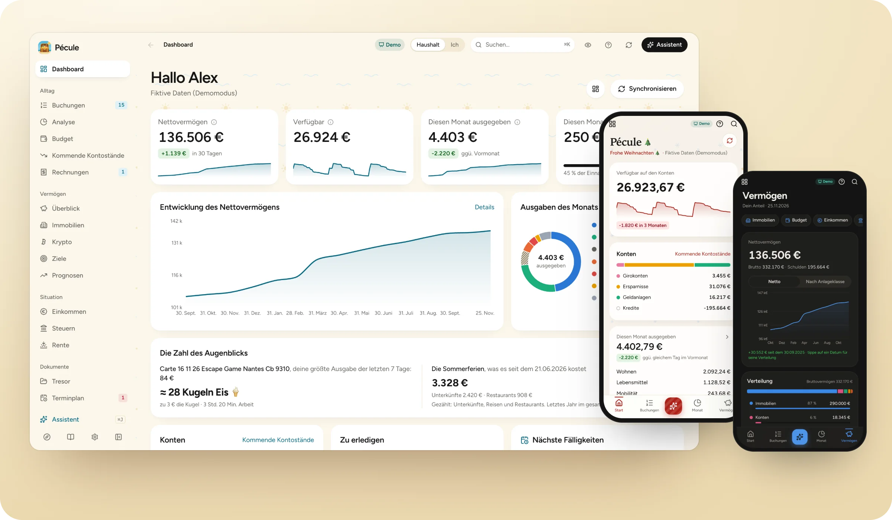
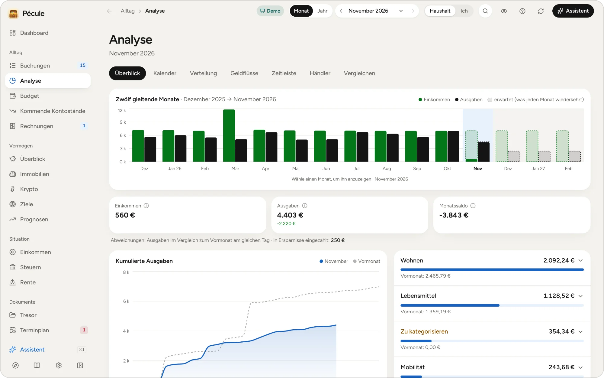
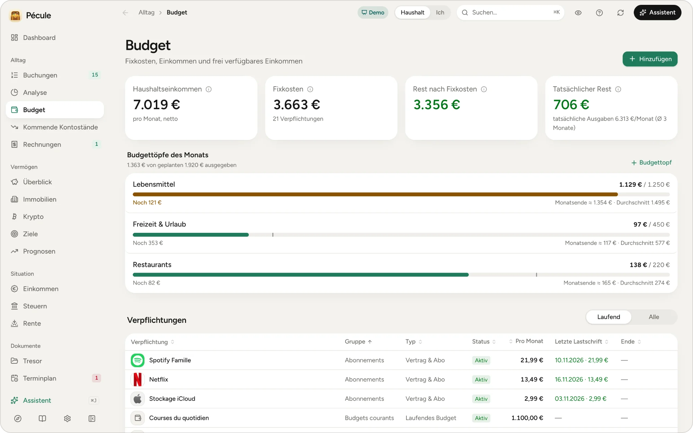
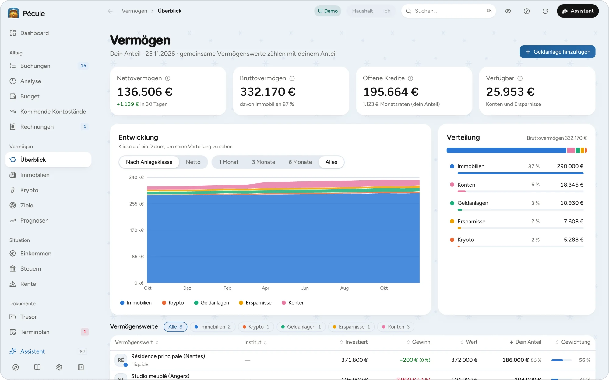
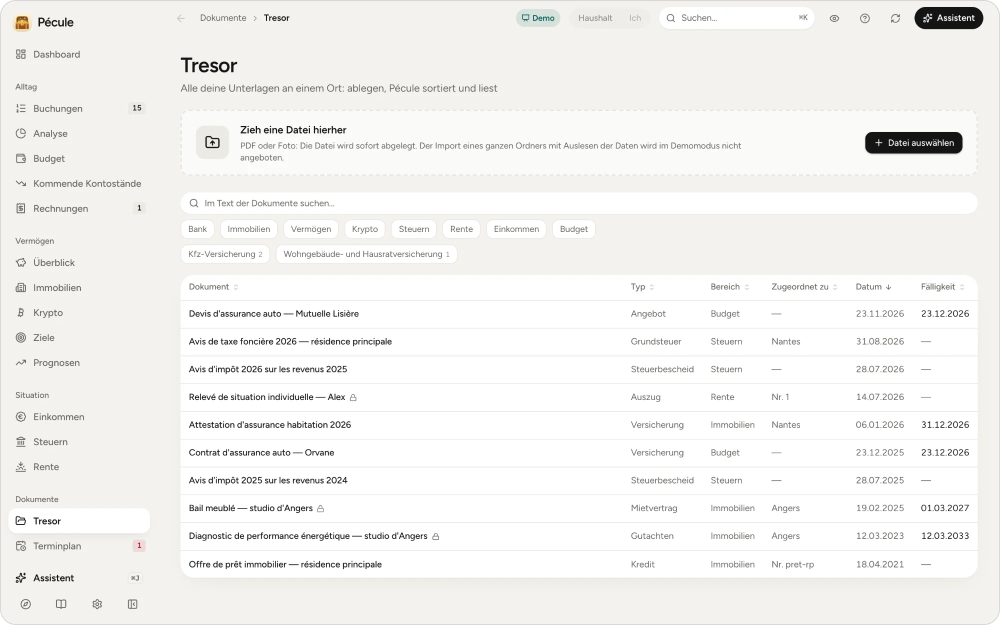
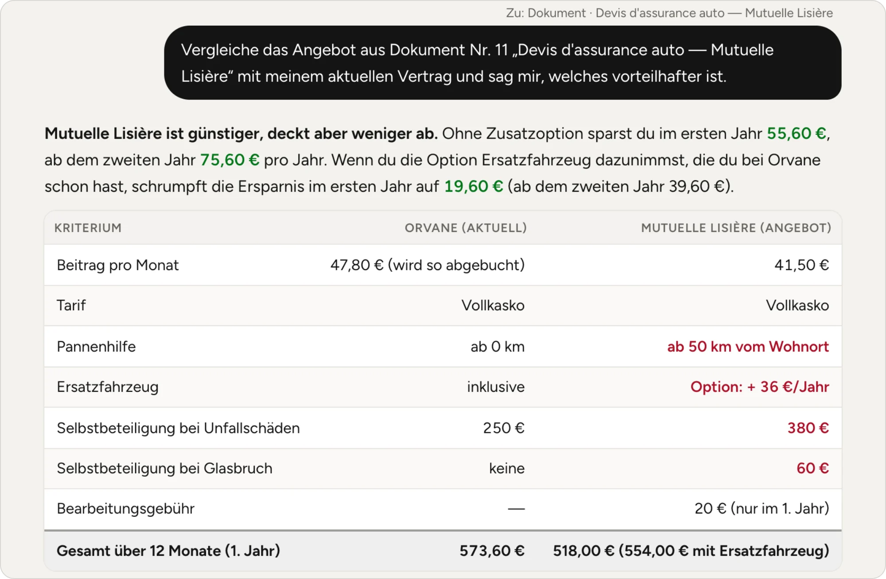
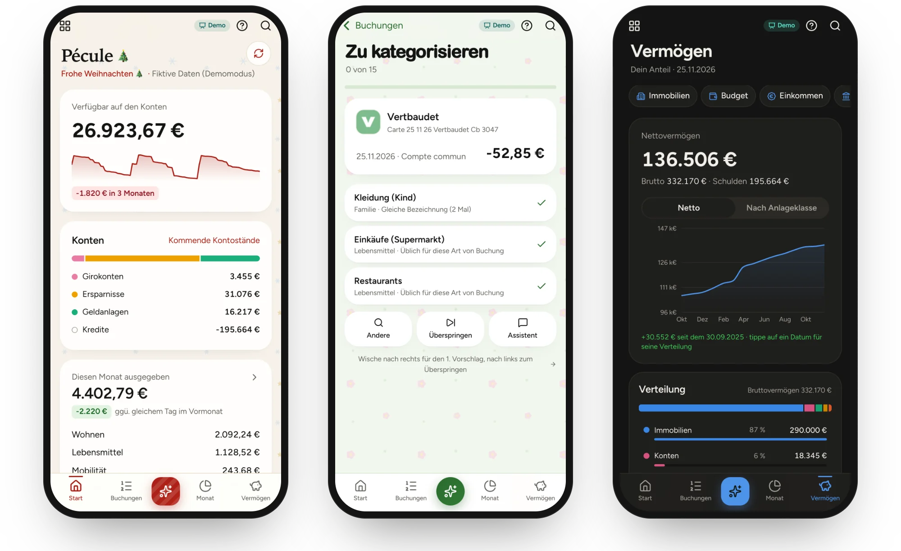
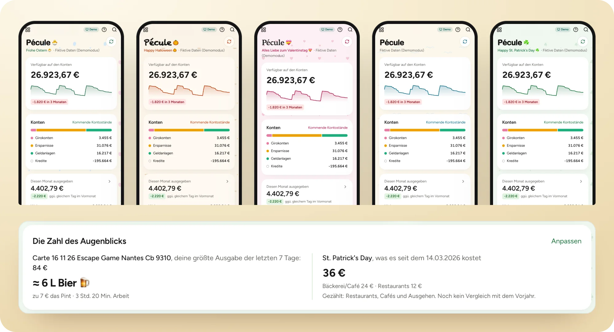

<div align="center">


# Pécule

**Alle Finanzen deines Haushalts. In einem Tresor, der dir gehört.**

Konten, Budget, Vermögen, Rechnungen, Dokumente, Steuern und Rente – am Computer und auf dem Handy.<br>
Selbst gehostet, kostenlos, frei und Open Source: Deine Daten bleiben auf deinem Server.

[](https://github.com/Enki-Engineer/pecule/releases/latest)
[](LICENSE)
[](https://github.com/Enki-Engineer/pecule/actions/workflows/ci.yml)
[](#installieren)
[](#was-es-kann)

[Installieren](#installieren) · [Was es kann](#was-es-kann) · [Ganz nach dir](#ganz-nach-dir) · [Verbinde deine KI](#verbinde-deine-ki) · [Deine Daten](#deine-daten-gehören-dir) · [Dokumentation](#dokumentation) · [Unterstützen](#pécule-unterstützen) · [Idee vorschlagen](https://github.com/Enki-Engineer/pecule/issues/new?template=idee.md)

[English](README.md) · [Français](README.fr.md) · **Deutsch** · [Italiano](README.it.md) · [Español](README.es.md)

</div>

<picture>
  <source media="(prefers-color-scheme: dark)" srcset="docs/images/de/ouverture-sombre.webp">
  
</picture>

Pécule ist zuerst für Frankreich und den Euro gedacht (französische Banken, Steuerbescheide, Gehaltsabrechnungen,
Rentenauskünfte) und spricht Französisch, Englisch, Deutsch, Italienisch und Spanisch. Eine Installation dient einem
Haushalt. Der Code und seine Kommentare sind auf Französisch geschrieben.

## Was es kann

- **Im Alltag** — die Buchungen all deiner Konten an einem Ort, eingeordnet nach Regeln, die du ihm beibringst, die
  Monatsanalyse, Budgettöpfe, kommende Kontostände, Rechnungen, die mit den Buchungen verknüpft sind, die sie bezahlt
  haben.
- **Vermögen** — Ersparnisse, Geldanlagen, Immobilien, Kredite mit ihren Tilgungsplänen, Krypto, Prognosen.
- **Analyse** — ein Monat oder ein Jahr aus sechs Blickwinkeln: zwölf Monate mit Prognose, die Verteilung in Ringen,
  ein Flussdiagramm, der Kalender der Lastschriften, die Zeitleiste der Zahlungen und ein Zeitraum im Vergleich mit
  einem anderen.
- **Gehalt** — deine Gehaltsabrechnungen, Monat für Monat gelesen (Brutto, steuerpflichtiges Netto, einbehaltene
  Steuer, Auszahlungsbetrag, Prämien), für dich oder für den Haushalt.
- **Steuern** — deine Bescheide, Jahr für Jahr gelesen: zu versteuerndes Einkommen, Nettosteuer, Grenzsteuersatz,
  Durchschnittssteuersatz, Ermäßigungen und Gutschriften, Grundsteuer je Immobilie; der Steuerkalender steht in deinem
  Terminplan. Frag den Assistenten, was eine Spende oder eine Einzahlung in einen Altersvorsorgeplan ändern würde oder
  welche Ausgaben für eine Steuergutschrift infrage kommen.
- **Rente** — Quartale, Erwerbsverlauf und Rente je nach Renteneintrittsalter; die offiziellen Simulationen neben
  einer vollständigen Laufbahn oder einem Ausstieg mit 55 (FIRE), Alter für Alter. *Steuern und Rente lesen derzeit
  französische Dokumente; weitere Länder folgen.*
- **Tresor** — jedes Dokument aufbewahrt und auffindbar, mit seinen wichtigsten Angaben und einem Terminplan dessen, was
  ansteht.
- **Massenimport von Dokumenten** — leg einen ganzen Ordner ab; Pécule ordnet jedes Dokument ein, liest die, die es kennt
  (Gehaltsabrechnungen, Steuerbescheide, Tilgungspläne, Kontoauszüge, Urkunden, Mietverträge…), prüft die Rechnung und
  schlägt die Daten vor. Nichts wird geschrieben, bevor du es bestätigst, und jeder Import lässt sich rückgängig machen.
- **Assistent** (optional) — stell deine Fragen, auch per Sprache; er kann handeln, mit deiner Bestätigung. Er kennt
  auch die App: Er erklärt, wie etwas geht, führt zum richtigen Bildschirm und ändert eine Einstellung, wenn du es
  verlangst.
- **Eingebautes Handbuch** — alles, was die App kann, nach Themen, mit Suche, in allen fünf Sprachen.
- **Ein geführter Einstieg** — bei der ersten Anmeldung wird jedes Mitglied von einer kurzen Einführung empfangen: den
  Haushalt einrichten, die Orientierungspunkte der App, dann Schritt für Schritt die eigene Bank anbinden. Ein
  Rundgang führt danach durch die App, eine Sprechblase nach der anderen, und lässt sich über das Menü wiederholen.
- **In deiner Währung** — der Haushalt wählt Land, Währung und Zeitzone; ein Konto in einer anderen Währung wird zum
  Referenzkurs der Europäischen Zentralbank vom Tag jeder Buchung umgerechnet und behält seine ursprünglichen Beträge.
- **Für einen Haushalt** — jedes Mitglied hat seine eigene Ansicht; gemeinsame und private Konten; Passkeys statt
  Passwörtern; ein Demomodus mit einer fiktiven Familie, um die App zu zeigen, ohne deine Konten zu zeigen.

<table>
  <tr>
    <td width="50%"><br><sub><b>Analyse</b> — zwölf rollierende Monate, der laufende Monat, wohin das Geld geht</sub></td>
    <td width="50%"><br><sub><b>Budget</b> — Fixkosten, was wirklich bleibt, Budgettöpfe, Verpflichtungen</sub></td>
  </tr>
  <tr>
    <td width="50%"><br><sub><b>Vermögen</b> — das Nettovermögen im Zeitverlauf, nach Anlageklasse, mit Krediten</sub></td>
    <td width="50%"><br><sub><b>Tresor</b> — jedes Dokument, auffindbar, mit seinen Fälligkeiten</sub></td>
  </tr>
</table>

### Ein Angebot? Vergleich es

Strom, Gas, Versicherung, Internet, Mobilfunk, Auto, Kredit: Gib dem Assistenten ein Angebot, und er vergleicht es
mit deinem laufenden Vertrag — mit dem, was du in zwölf Monaten wirklich gezahlt hast, Leistung für Leistung — und sagt
dir, ob sich der Wechsel lohnt und bis wann du kündigen kannst.



### Auf deinem Handy

Leg Pécule auf deinen Startbildschirm: Es verhält sich wie eine App, mit einem Sortiermodus, um die Buchungen des
Tages mit ein paar Wischgesten einzuordnen.



## Ganz nach dir

Ein Dashboard, das du Karte für Karte zusammenstellst, sieben Farben, hell oder dunkel, und Themen, die dem Jahr
folgen — Weihnachten, Ostern, Halloween, Sommer… — jedes mit seiner eigenen Schatztruhe. Am Anfang ist kein Thema
aktiv: Du schaltest sie ein.

Und weil Geld nicht immer ernst sein muss, schreiben die **lustigen Umrechnungen** einen Betrag auch in der
Einheit des Augenblicks: Liter Bier am St. Patrick's Day, Kugeln Eis im Sommer, Kilo Süßigkeiten an Halloween — und das
ganze Jahr über in Arbeitsstunden, berechnet aus deinen Gehaltsabrechnungen.



## Verbinde deine KI

Pécule stellt einen **MCP-Server** bereit: Verbinde deinen bevorzugten KI-Assistenten und erledige alles von dort
aus — eine Buchung finden, einen Stapel einordnen, einen Monat analysieren, einen Vertrag vergleichen, dein Vermögen
aktualisieren. Achtundsechzig Werkzeuge, nur lesend oder mit Aktionen: Er liest und handelt in deinem Pécule, mit den
Rechten, die du ihm gibst.

Pécule erkennt Claude, ChatGPT, Mistral Le Chat und Perplexity sowie jeden Assistenten auf deinem Computer
(Claude Code, Codex, Cursor, Gemini CLI…). Sie melden sich mit deinem Passkey an; Einstellungen → Konten und
Verbindungen → „Verbundene Apps“ nennt die Adresse.

## Deine Daten gehören dir

Pécule läuft auf deinem eigenen Server: Deine Konten, deine Dokumente und dein Verlauf bleiben dort. Kein Konto beim
Projekt, keine Telemetrie, keine Werbung. Kein Verkauf von Daten an Dritte, keine unerwünschte Kontaktaufnahme.

- **Kostenlos, frei und Open Source** — AGPL-3.0: Der Code ist öffentlich; du kannst ihn lesen, ändern, hosten.
- **Bei dir** — eine Installation dient einem Haushalt; die Daten bleiben in deiner Datenbank.
- **Kein Verkauf, keine Werbeanrufe** — niemand ruft dich an, um dir einen Kredit oder eine Versicherung zu verkaufen.
- **Deine Schlüssel, nicht unsere** — deine Bank nur lesend mit deinem eigenen Enable-Banking-Schlüssel; KI, wenn du sie
  willst, mit deinem eigenen Schlüssel.

## Woher die Daten kommen

Nichts ist Pflicht: Nimm, was zu dir passt.

| Quelle | Wie |
| --- | --- |
| Deine Bank, nur lesend | [Enable Banking](docs/connecteurs/enable-banking.md) (PSD2, kostenlos für die private Nutzung) |
| Bankdateien | OFX-, QIF- oder CSV-Exporte, ohne Dubletten erneut importierbar |
| Von Hand | Konten und Buchungen, die du selbst führst |
| Dokumente | der Massenimport oder eine Datei nach der anderen |

Die KI-Funktionen (Lesen von Rechnungen und Dokumenten, Assistent) laufen über **deinen eigenen**
Anbieterschlüssel — Claude über die Anthropic-API, Microsoft Foundry oder ein kompatibles Gateway. Ohne Schlüssel
funktioniert alles andere.

## Installieren

Jede Version erscheint in drei Formaten, angehängt an [ihre Seite](https://github.com/Enki-Engineer/pecule/releases/latest):

| Format | Für wen | Was du brauchst |
| --- | --- | --- |
| **Docker** — eine Datei, `compose.yaml` | Ein Computer, ein Server, ein NAS. Am einfachsten: die App und ihre Datenbank zusammen. | Docker mit Compose 2 (getestet von 2.9 bis 5.5) |
| **Fertiges Archiv** — `npm create pecule`, oder `pecule.tar.gz` / `pecule.zip` von Hand | Node.js-Hosting ohne Docker. Der Server ist bereits gebaut. | Node.js 24, MariaDB 10.6+ oder MySQL 8+ |
| **Quellcode** — `git clone -b stable` | Mitentwickeln, oder ein Hoster, der von GitHub baut. | Node.js 24, pnpm, eine Datenbank |

Mit Docker drei Befehle — nichts zu klonen, kein Node, keine Einstellungsdatei zu schreiben:

```sh
curl -fsSLO https://github.com/Enki-Engineer/pecule/releases/latest/download/compose.yaml
docker compose up -d                                 # http://localhost:3000
docker compose exec pecule node scripts/lien.mjs     # der Link, den du öffnest, um deinen Haushalt anzulegen
```

Ohne Docker — Node.js 24 und eine leere MariaDB- oder MySQL-Datenbank — holt ein Befehl das fertige Archiv der
neuesten Version, prüft es und entpackt es nach `./pecule`, dann zeigt er die drei Befehle, die folgen
(Einstellungen, Server, erster Link):

```sh
npm create pecule
```

**Oder überlass es deinem KI-Assistenten** — Claude Code, Codex, Gemini CLI, Cursor, Copilot, jeder Agent, der
Befehle ausführen kann. Gib ihm das hier:

> Installiere Pécule für mich nach den Anweisungen unter
> https://raw.githubusercontent.com/Enki-Engineer/pecule/stable/AGENTS.md — lies die ganze Datei mit curl.
> Ich möchte es auf diesem Computer ausprobieren.

Die [Installationsanleitung](docs/guide/installation.md) behandelt den Server mit https, das Archiv, die Sicherungen
und den Umzug auf einen anderen Server; [Installieren mit einer KI](docs/guide/installer-avec-une-ia.md) sagt, was der
Agent tut und was bei dir bleibt (Claude Code: `/plugin install pecule --marketplace Enki-Engineer/pecule` gibt ihm die
Fähigkeit). Pécule meldet seinem Administrator, wenn eine Version erscheint, und zeigt den Befehl, der sie installiert
([Aktualisieren](docs/guide/mise-a-jour.md)). Läuft der Server, leg Pécule auf den Startbildschirm deines Handys oder
ins Dock: Es verhält sich wie eine App. Die Anleitungen sind auf Französisch geschrieben.

## Dokumentation

- [Installation](docs/guide/installation.md) · [Installieren mit einer KI](docs/guide/installer-avec-une-ia.md) · [Aktualisieren](docs/guide/mise-a-jour.md)
- [Banken mit Enable Banking anbinden](docs/connecteurs/enable-banking.md)
- [Dokumente importieren](docs/guide/importer-des-documents.md) · [Wo du deine Dokumente findest](docs/guide/recuperer-ses-documents.md)
- [Architektur](docs/ARCHITECTURE.md) · [Mitwirken](CONTRIBUTING.md) · [Sicherheit](SECURITY.md)

## Ein junges Projekt, das schnell vorankommt

Die erste öffentliche Version von Pécule stammt vom November 2026, und jede Woche kommen Neuerungen hinzu: Die
[Versionshinweise](https://github.com/Enki-Engineer/pecule/releases) sagen, was sich für einen Haushalt ändert.

- Eine Idee, etwas fehlt? [Schlag sie vor](https://github.com/Enki-Engineer/pecule/issues/new?template=idee.md).
- Etwas funktioniert nicht? [Melde ein Problem](https://github.com/Enki-Engineer/pecule/issues/new?template=probleme.md)
  (häng niemals echte Bankdaten an: Der Demomodus stellt es fast immer nach).
- Lust, am Code mitzuhelfen? Siehe [Mitwirken](CONTRIBUTING.md).

## Pécule unterstützen

Pécule ist kostenlos und bleibt es. So hilfst du: ein Stern auf dieser Seite (kostet nichts und zählt), erzähl anderen
davon, [schlag eine Idee vor](https://github.com/Enki-Engineer/pecule/issues/new?template=idee.md) — oder spendier mir
einen Kaffee:

**GitHub Sponsors** — [github.com/sponsors/kfr-kevinferreira](https://github.com/sponsors/kfr-kevinferreira): monatlich oder einmalig, in der Höhe deiner Wahl.

**Liberapay** — [liberapay.com/pecule](https://liberapay.com/pecule): eine regelmäßige Spende, per Karte oder Lastschrift.

**Bitcoin (BTC)**

```text
bc1q6d23e8fkm7fnz3ulzj97mpdhh7h6kk4lesxhvu
```

**Ethereum (ETH)**

```text
0xDb3f435b19237881Ab00Bfa88FE397516DC36cF7
```

Beide Adressen sind ausschließlich für Spenden an Pécule bestimmt.

## Technik

Node.js 24, Express 5, React 19, Vite, Tailwind CSS 4, TypeScript, Drizzle ORM, MySQL oder MariaDB. Kein Konto bei
uns, keine Telemetrie, kein externer Dienst erforderlich.

## Dank

An [Enable Banking](https://enablebanking.com), die ihren Dienst für die private Nutzung kostenlos anbieten: So
liest Pécule deine Konten, nur lesend, über den offiziellen Weg der europäischen Regulierung (PSD2). Du gibst deine
Zustimmung bei deiner Bank, und Pécule sieht deine Zugangsdaten nie.

## Autor

Pécule wird von **Kevin Ferreira** entwickelt und gepflegt —
[LinkedIn](https://www.linkedin.com/in/ferreirakevin) · [GitHub](https://github.com/kfr-kevinferreira).

## Lizenz

[AGPL-3.0-only](LICENSE). Wenn du ein verändertes Pécule für andere betreibst, musst du ihnen dessen Quellcode
anbieten.

Pécule ist ein persönliches Projekt, geteilt wie es ist. Es ist weder eine Finanz- noch eine Steuer- noch eine
Rechtsberatung.
