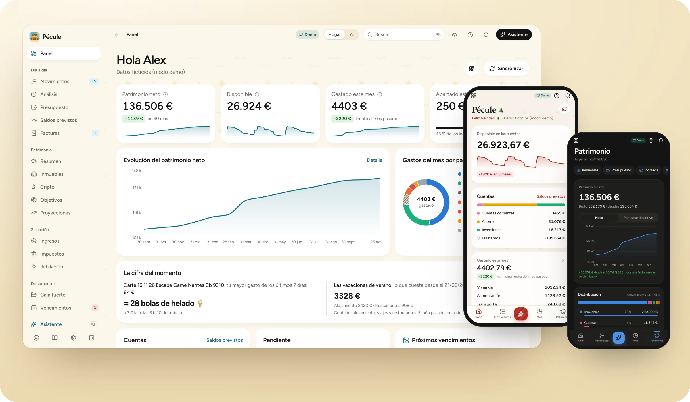
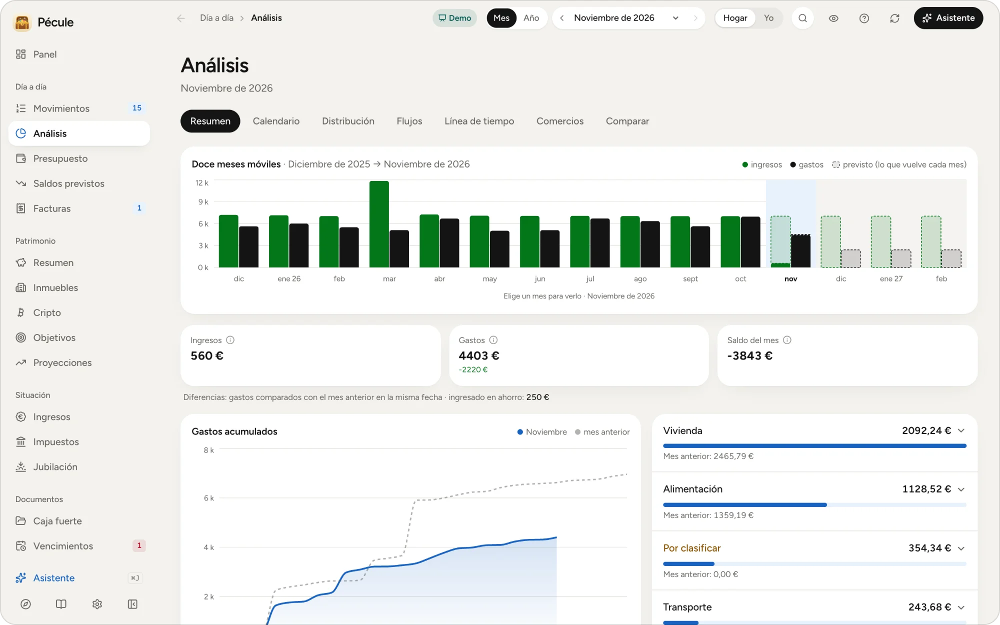
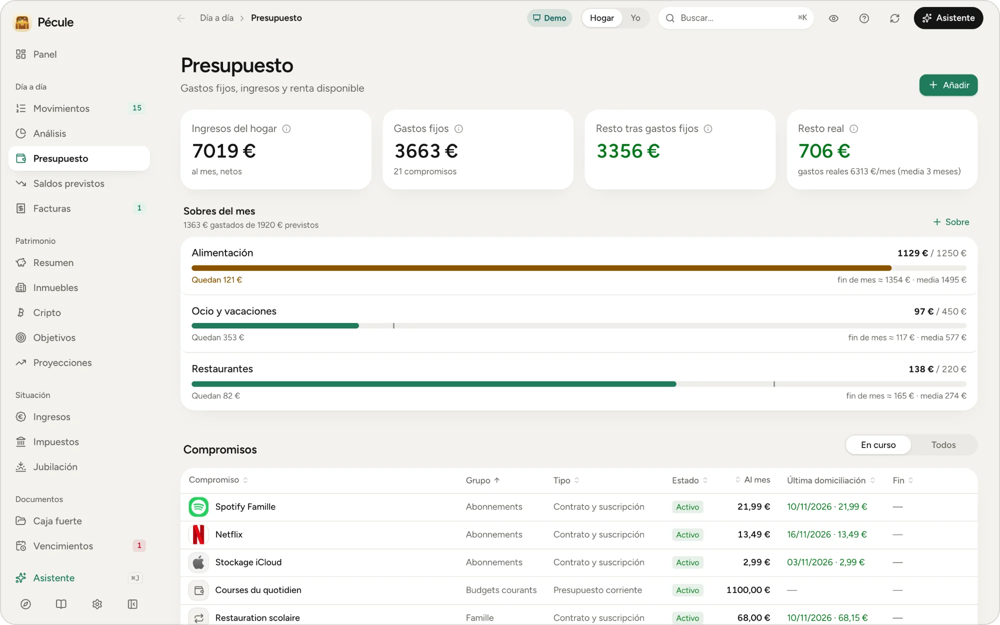
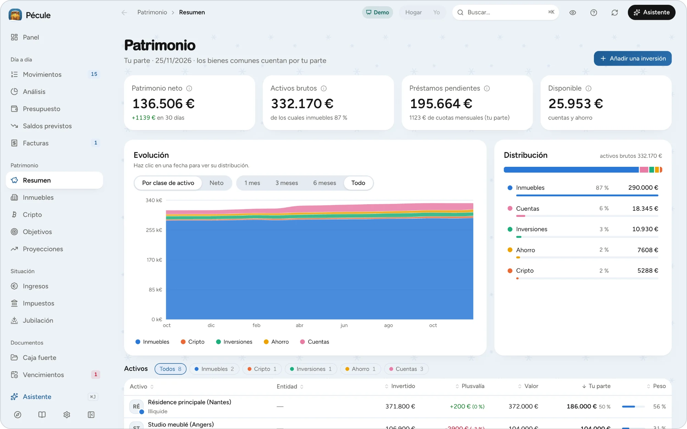
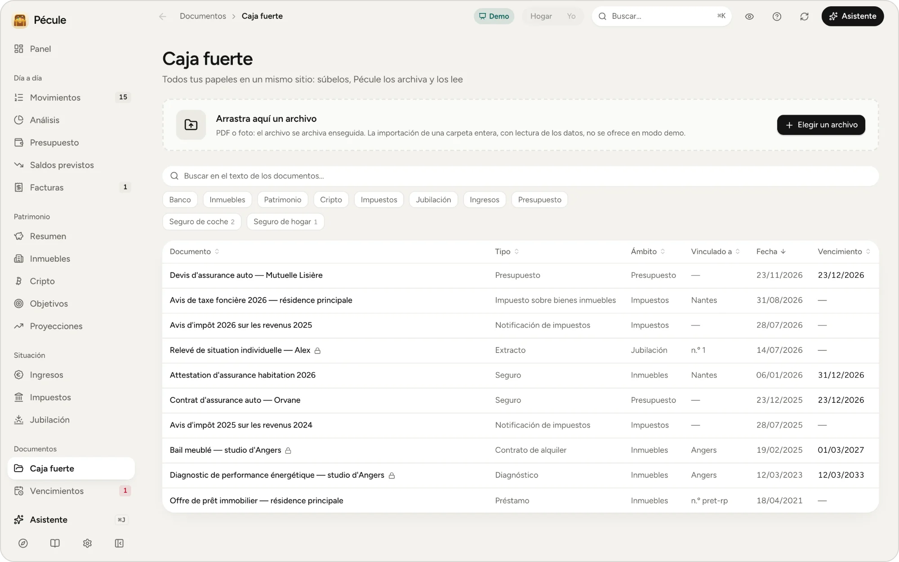
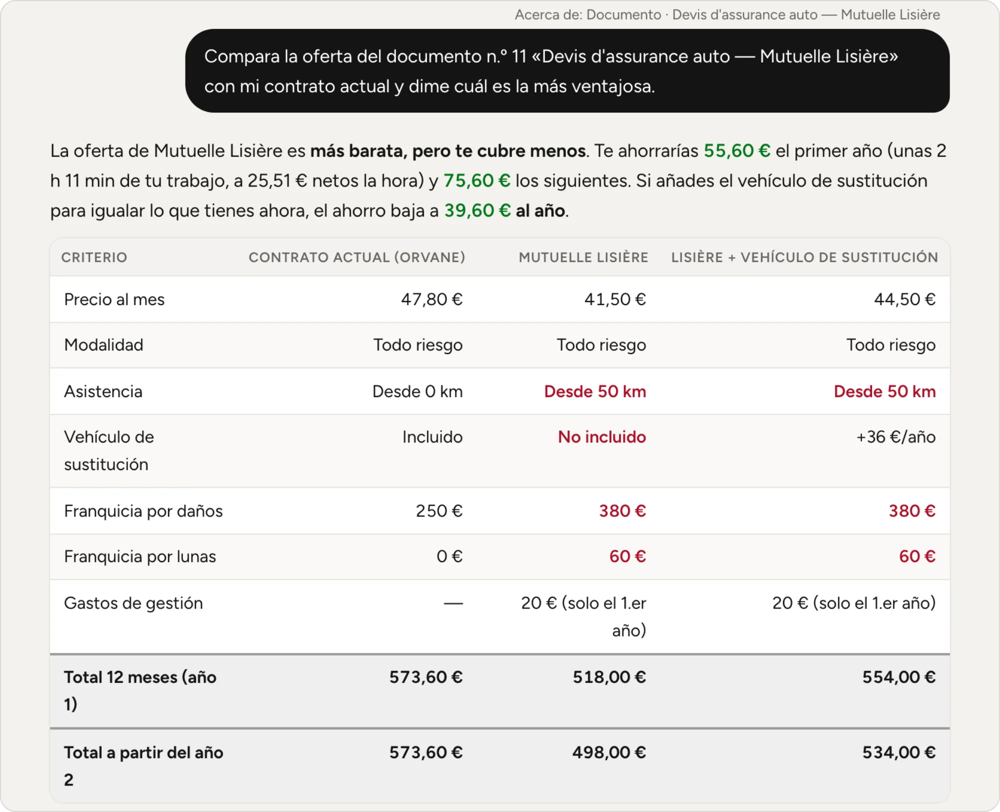
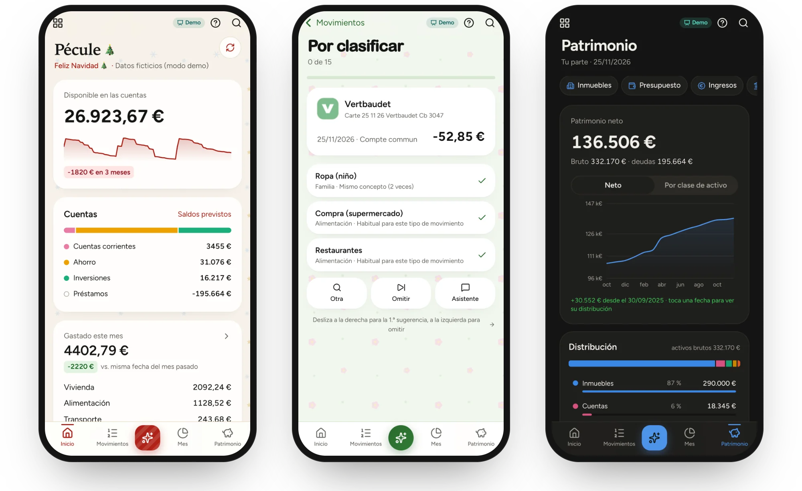
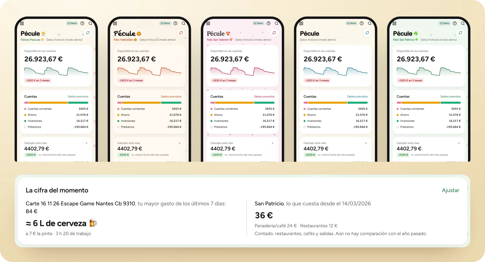

<div align="center">


# Pécule

**Todas las finanzas de tu hogar. En una caja fuerte que te pertenece.**

Cuentas, presupuesto, patrimonio, facturas, documentos, impuestos y jubilación, en el ordenador y en el teléfono.<br>
Alojado en tu casa, gratuito, libre y de código abierto: tus datos se quedan en tu servidor.

[](https://github.com/Enki-Engineer/pecule/releases/latest)
[](LICENSE)
[](https://github.com/Enki-Engineer/pecule/actions/workflows/ci.yml)
[](#instalar)
[](#qué-hace)

[Instalar](#instalar) · [Qué hace](#qué-hace) · [Con tus colores](#con-tus-colores) · [Conecta tu IA](#conecta-tu-ia) · [Tus datos](#tus-datos-te-pertenecen) · [Documentación](#documentación) · [Apoyar](#apoyar-a-pécule) · [Proponer una idea](https://github.com/Enki-Engineer/pecule/issues/new?template=idee.md)

[English](README.md) · [Français](README.fr.md) · [Deutsch](README.de.md) · [Italiano](README.it.md) · **Español**

</div>

<picture>
  <source media="(prefers-color-scheme: dark)" srcset="docs/images/es/ouverture-sombre.webp">
  
</picture>

Pécule está pensado ante todo para Francia y el euro (bancos franceses, avisos de impuestos, nóminas, informes de
vida laboral) y habla francés, inglés, alemán, italiano y español. Una instalación sirve a un hogar. El código y sus
comentarios están escritos en francés.

## Qué hace

- **En el día a día** — los movimientos de todas tus cuentas en un solo lugar, clasificados con reglas que tú le
  enseñas, el análisis del mes, sobres de presupuesto, saldos previstos, facturas vinculadas a los movimientos que las
  pagaron.
- **Patrimonio** — ahorros, inversiones, inmuebles, préstamos con sus cuadros de amortización, cripto, proyecciones.
- **Análisis** — un mes o un año desde seis ángulos: doce meses con su previsión, la distribución en anillos, el
  diagrama de flujos, el calendario de los cargos, la línea de tiempo de los pagos y un periodo frente a otro.
- **Nómina** — tus nóminas leídas mes a mes (bruto, neto imponible, impuesto retenido, neto pagado, primas), para ti o
  para el hogar.
- **Impuestos** — tus avisos leídos año tras año: renta imponible, impuesto neto, tipo marginal, tipo medio,
  reducciones y créditos, impuesto inmobiliario de cada inmueble; el calendario fiscal en tus vencimientos. Pregunta
  al asistente qué cambiaría una donación o una aportación a un plan de pensiones, o qué gastos pueden dar derecho a
  un crédito fiscal.
- **Jubilación** — trimestres, vida laboral y pensión según la edad de salida; las simulaciones oficiales junto a una
  carrera completa o un retiro a los 55 años (FIRE), edad por edad. *Impuestos y jubilación leen hoy documentos
  franceses; otros países llegarán.*
- **Caja fuerte** — cada documento guardado y localizable, con sus datos clave y el calendario de lo que viene.
- **Importación masiva de documentos** — deposita una carpeta entera; Pécule archiva cada documento, lee los que conoce
  (nóminas, avisos de impuestos, cuadros de amortización, extractos, escrituras, contratos de alquiler…), comprueba las
  cuentas y propone los datos. Nada se escribe antes de tu validación, y toda importación se puede deshacer.
- **Asistente** (opcional) — haz tus preguntas, también por voz; puede actuar, con tu confirmación. También conoce la
  aplicación: explica cómo hacer las cosas, lleva a la pantalla adecuada y cambia un ajuste si se lo pides.
- **Manual integrado** — todo lo que sabe hacer la aplicación, por temas, con búsqueda, en los cinco idiomas.
- **Un inicio guiado** — en su primera conexión, cada miembro es recibido por una breve presentación: el hogar por
  configurar, las referencias de la aplicación y luego su banco por conectar, paso a paso. Después, una visita guiada
  recorre la aplicación, un bocadillo tras otro, y se puede repetir desde el menú.
- **En tu moneda** — el hogar elige su país, su moneda y su zona horaria; una cuenta en otra moneda se convierte al tipo
  de referencia del Banco Central Europeo del día de cada movimiento y conserva sus importes originales.
- **Para un hogar** — cada miembro tiene su vista; cuentas comunes y cuentas privadas; llaves de acceso en lugar de
  contraseñas; un modo demo con una familia ficticia, para enseñar la aplicación sin enseñar tus cuentas.

<table>
  <tr>
    <td width="50%"><br><sub><b>Análisis</b> — doce meses móviles, el mes en curso, adónde va el dinero</sub></td>
    <td width="50%"><br><sub><b>Presupuesto</b> — gastos fijos, lo que queda de verdad, sobres, compromisos</sub></td>
  </tr>
  <tr>
    <td width="50%"><br><sub><b>Patrimonio</b> — el patrimonio neto en el tiempo, por tipo de activo, préstamos incluidos</sub></td>
    <td width="50%"><br><sub><b>Caja fuerte</b> — cada documento, localizable, con sus vencimientos</sub></td>
  </tr>
</table>

### ¿Un presupuesto? Compáralo

Luz, gas, seguro, internet, móvil, coche, préstamo: dale una oferta al asistente y la compara con tu contrato en
vigor — lo que has pagado de verdad en doce meses, cobertura por cobertura — y te dice si merece la pena cambiar, y
hasta cuándo puedes darte de baja.



### En tu teléfono

Añade Pécule a tu pantalla de inicio: se comporta como una aplicación, con un modo de clasificación para ordenar
los movimientos del día con unos pocos gestos.



## Con tus colores

Un panel que compones tarjeta a tarjeta, siete colores, claro u oscuro, y temas que siguen el año — Navidad,
Pascua, Halloween, el verano… — cada uno con su cofre. Al principio no hay ningún tema activo: los activas tú.

Y como el dinero no tiene por qué ser siempre serio, las **equivalencias divertidas** escriben también un importe
en la unidad del momento: litros de cerveza en San Patricio, bolas de helado en verano, kilos de caramelos en
Halloween — y, todo el año, en horas de trabajo, calculadas a partir de tus nóminas.



## Conecta tu IA

Pécule expone un **servidor MCP**: conecta tu asistente de IA favorito y hazlo todo desde él — encontrar un
movimiento, clasificar un lote, analizar un mes, comparar un contrato, actualizar tu patrimonio. Sesenta y ocho
herramientas, en solo lectura o con acciones: lee y actúa sobre tu Pécule, con los permisos que le das.

Pécule reconoce a Claude, ChatGPT, Mistral Le Chat y Perplexity, además de cualquier asistente de tu ordenador
(Claude Code, Codex, Cursor, Gemini CLI…). Se conectan con tu llave de acceso; Ajustes → Cuentas y conexiones →
«Aplicaciones conectadas» indica la dirección.

## Tus datos te pertenecen

Pécule se instala en tu casa: tus cuentas, tus documentos y tu historial se quedan en tu servidor. Ninguna cuenta
que abrir con el proyecto, sin telemetría, sin publicidad. Ninguna venta de datos a terceros, ningún contacto no
solicitado.

- **Gratuito, libre y de código abierto** — licencia AGPL-3.0: el código es público, puedes leerlo, modificarlo,
  alojarlo.
- **En tu casa** — una instalación sirve a un hogar; los datos se quedan en tu base de datos.
- **Ninguna venta, ninguna llamada comercial** — nadie te llamará para venderte un préstamo o un seguro.
- **Tus llaves, no las nuestras** — tu banco en solo lectura con tu propia clave de Enable Banking; la IA, si la
  quieres, con tu propia clave.

## De dónde vienen los datos

Nada es obligatorio: toma lo que te convenga.

| Fuente | Cómo |
| --- | --- |
| Tu banco, en solo lectura | [Enable Banking](docs/connecteurs/enable-banking.md) (PSD2, gratuito para uso personal) |
| Archivos del banco | exportaciones OFX, QIF o CSV, reimportables sin duplicados |
| A mano | cuentas y movimientos que llevas tú mismo |
| Documentos | la importación masiva, o un archivo cada vez |

Las funciones de IA (lectura de facturas y documentos, asistente) pasan por **tu** clave de proveedor — Claude
mediante la API de Anthropic, Microsoft Foundry o una pasarela compatible. Sin clave, todo lo demás funciona.

## Instalar

Cada versión se publica en tres formatos, adjuntos a [su página](https://github.com/Enki-Engineer/pecule/releases/latest):

| Formato | Para quién | Qué necesitas |
| --- | --- | --- |
| **Docker** — un archivo, `compose.yaml` | Un ordenador, un servidor, un NAS. Lo más sencillo: la aplicación y su base de datos juntas. | Docker con Compose 2 (probado de la 2.9 a la 5.5) |
| **Archivo listo para usar** — `npm create pecule`, o `pecule.tar.gz` / `pecule.zip` a mano | Un alojamiento Node.js sin Docker. El servidor ya está construido. | Node.js 24, MariaDB 10.6+ o MySQL 8+ |
| **Código fuente** — `git clone -b stable` | Contribuir, o un alojamiento que construye desde GitHub. | Node.js 24, pnpm, una base de datos |

Con Docker, tres comandos — nada que clonar, sin Node, ningún archivo de ajustes que escribir:

```sh
curl -fsSLO https://github.com/Enki-Engineer/pecule/releases/latest/download/compose.yaml
docker compose up -d                                 # http://localhost:3000
docker compose exec pecule node scripts/lien.mjs     # el enlace que abres para crear tu hogar
```

Sin Docker — Node.js 24 y una base de datos MariaDB o MySQL vacía —, un comando descarga el archivo listo para usar
de la última versión, lo comprueba y lo descomprime en `./pecule`, y después muestra los tres comandos que siguen
(ajustes, servidor, primer enlace):

```sh
npm create pecule
```

**O deja que lo haga tu asistente de IA** — Claude Code, Codex, Gemini CLI, Cursor, Copilot, cualquier agente capaz
de ejecutar comandos. Pégale esto:

> Instala Pécule por mí siguiendo las instrucciones de
> https://raw.githubusercontent.com/Enki-Engineer/pecule/stable/AGENTS.md — lee el archivo entero con curl.
> Quiero probarlo en este ordenador.

La [guía de instalación](docs/guide/installation.md) trata del servidor con https, del archivo, de las copias de
seguridad y del cambio de servidor; [instalar con una IA](docs/guide/installer-avec-une-ia.md) explica qué hace el
agente y qué queda en tus manos (Claude Code: `/plugin install pecule --marketplace Enki-Engineer/pecule` le da la
habilidad). Pécule avisa a su administrador cuando se publica una versión y muestra el comando que la instala
([actualizar](docs/guide/mise-a-jour.md)). Con el servidor en marcha, añade Pécule a la pantalla de inicio del teléfono
o al Dock: se comporta como una aplicación. Las guías están escritas en francés.

## Documentación

- [Instalación](docs/guide/installation.md) · [Instalar con una IA](docs/guide/installer-avec-une-ia.md) · [Actualizar](docs/guide/mise-a-jour.md)
- [Conectar tus bancos con Enable Banking](docs/connecteurs/enable-banking.md)
- [Importar tus documentos](docs/guide/importer-des-documents.md) · [Dónde conseguir tus documentos](docs/guide/recuperer-ses-documents.md)
- [Arquitectura](docs/ARCHITECTURE.md) · [Contribuir](CONTRIBUTING.md) · [Seguridad](SECURITY.md)

## Un proyecto joven, que avanza rápido

La primera versión pública de Pécule es de noviembre de 2026, y cada semana llegan novedades: las
[notas de versión](https://github.com/Enki-Engineer/pecule/releases) cuentan qué cambia para un hogar.

- ¿Una idea, algo que falta? [Proponla](https://github.com/Enki-Engineer/pecule/issues/new?template=idee.md).
- ¿Algo no funciona? [Informa de un problema](https://github.com/Enki-Engineer/pecule/issues/new?template=probleme.md)
  (no adjuntes nunca datos bancarios reales: el modo demo casi siempre permite reproducirlo).
- ¿Quieres ayudar con el código? Mira [Contribuir](CONTRIBUTING.md).

## Apoyar a Pécule

Pécule es gratuito y lo seguirá siendo. Para ayudar: una estrella en esta página (no cuesta nada y cuenta), habla de
él a tu alrededor, [propón una idea](https://github.com/Enki-Engineer/pecule/issues/new?template=idee.md) — o invítame
a un café:

**Bitcoin (BTC)**

```text
bc1q6d23e8fkm7fnz3ulzj97mpdhh7h6kk4lesxhvu
```

**Ethereum (ETH)**

```text
0xDb3f435b19237881Ab00Bfa88FE397516DC36cF7
```

Ambas direcciones están dedicadas a las donaciones para Pécule.

## Tecnologías

Node.js 24, Express 5, React 19, Vite, Tailwind CSS 4, TypeScript, Drizzle ORM, MySQL o MariaDB. Ninguna cuenta con
nosotros, sin telemetría, ningún servicio externo obligatorio.

## Agradecimientos

A [Enable Banking](https://enablebanking.com), que ofrece su servicio gratis para uso personal: gracias a ellos
Pécule lee tus cuentas en solo lectura, por la vía oficial prevista por la normativa europea (PSD2). Das tu
consentimiento en tu banco, y Pécule nunca ve tus credenciales.

## Autor

Pécule está creado y mantenido por **Kevin Ferreira** —
[LinkedIn](https://www.linkedin.com/in/ferreirakevin) · [GitHub](https://github.com/kfr-kevinferreira).

## Licencia

[AGPL-3.0-only](LICENSE). Si ejecutas un Pécule modificado para otras personas, debes ofrecerles su código fuente.

Pécule es un proyecto personal compartido tal cual. No es asesoramiento financiero, fiscal ni jurídico.
