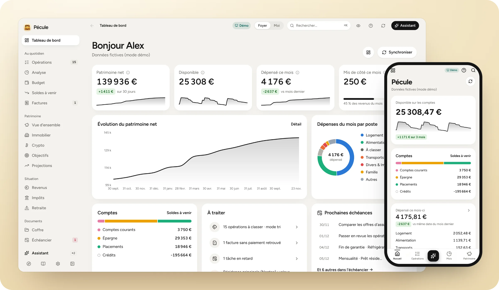
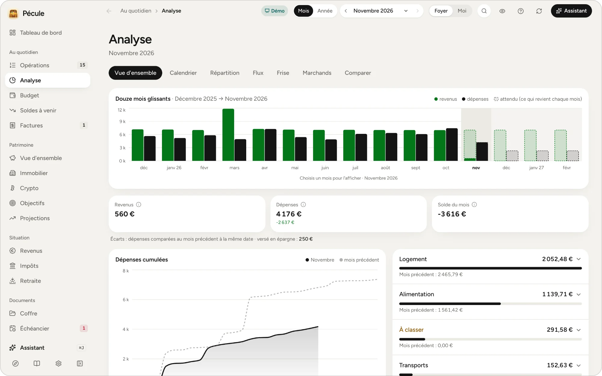
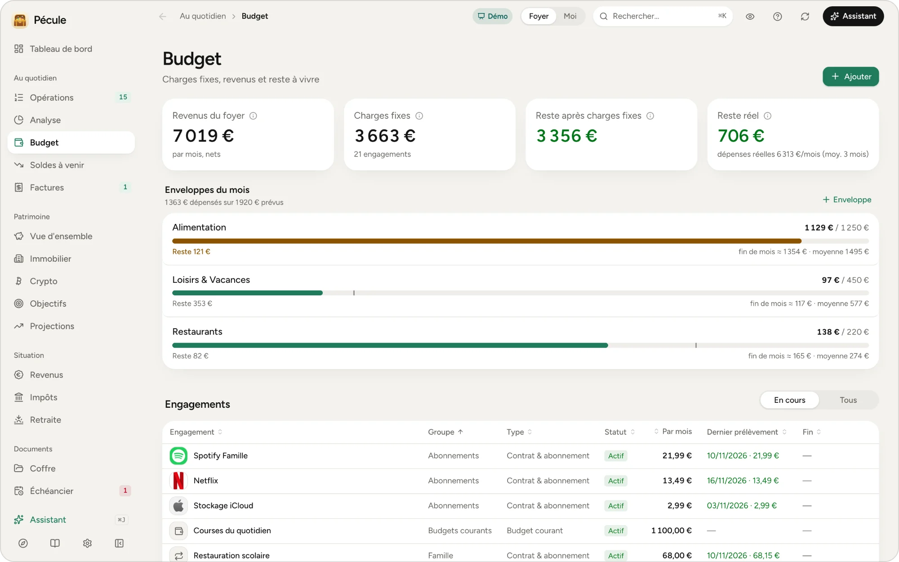
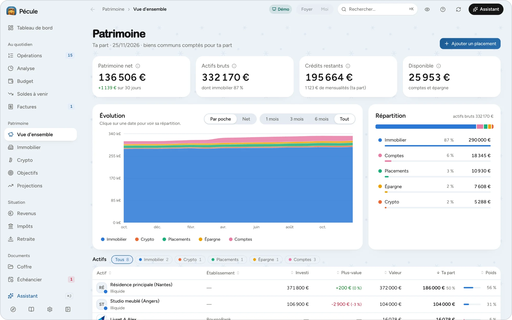
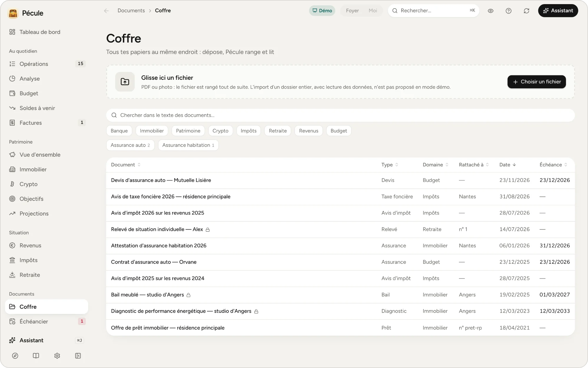
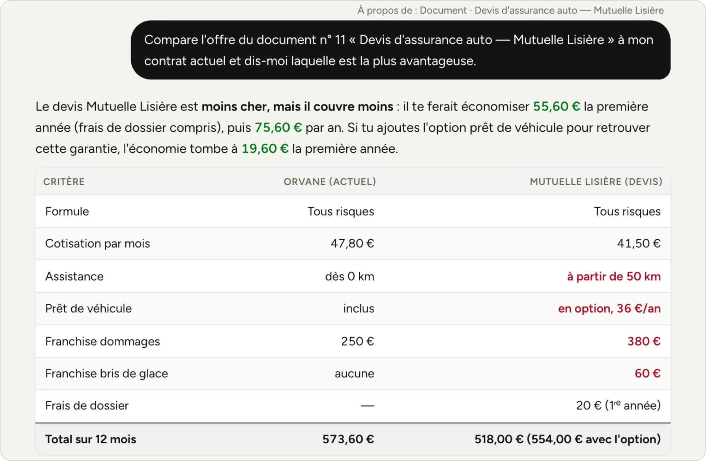
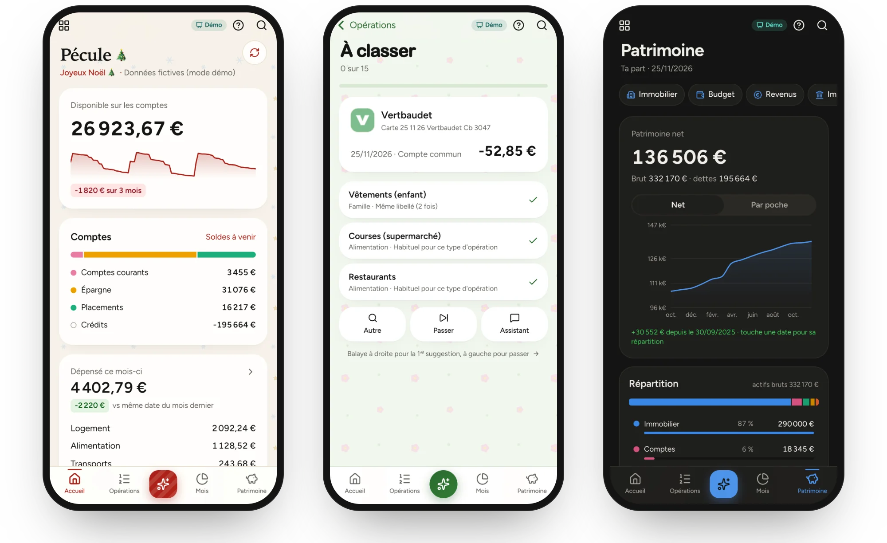
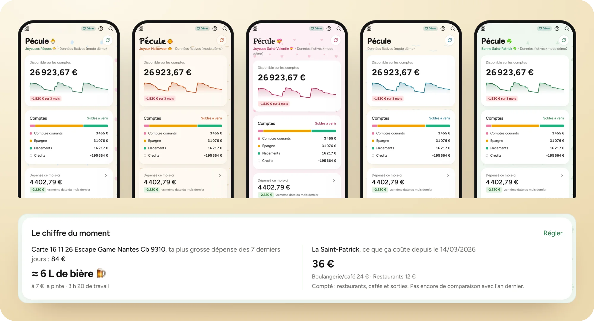

<div align="center">


# Pécule

**Toutes les finances de ton foyer. Dans un coffre qui t'appartient.**

Comptes, budget, patrimoine, factures, documents, impôts et retraite, sur ordinateur et sur téléphone.<br>
Hébergé chez toi, gratuit, libre et open source : tes données restent sur ton serveur.

[](https://pecule.org)
[](https://github.com/Enki-Engineer/pecule/releases/latest)
[](LICENSE)
[](https://github.com/Enki-Engineer/pecule/actions/workflows/ci.yml)
[](#installer)
[](#ce-quil-fait)

[Site](https://pecule.org) · [Installer](#installer) · [Ce qu'il fait](#ce-quil-fait) · [À tes couleurs](#à-tes-couleurs) · [Branche ton IA](#branche-ton-ia) · [Tes données](#tes-données-tappartiennent) · [Documentation](#documentation) · [Soutenir](#soutenir-pécule) · [Proposer une idée](https://github.com/Enki-Engineer/pecule/issues/new?template=idee.md)

[English](README.md) · **Français** · [Deutsch](README.de.md) · [Italiano](README.it.md) · [Español](README.es.md)

</div>

<picture>
  <source media="(prefers-color-scheme: dark)" srcset="docs/images/fr/ouverture-sombre.webp">
  
</picture>

Pécule est pensé d'abord pour la France et l'euro (banques françaises, avis d'impôt, bulletins de paie, relevés de
carrière), et parle français, anglais, allemand, italien et espagnol. Une installation sert un foyer. Le code et ses
commentaires sont en français.

**Pécule en 70 secondes**

https://github.com/user-attachments/assets/fdd6d964-d034-4faa-8411-1a4719270c20

## Ce qu'il fait

- **Au quotidien** — les opérations de tous tes comptes au même endroit, classées par des règles que tu lui apprends,
  l'analyse du mois, des enveloppes de budget, les soldes à venir, les factures reliées aux opérations qui les ont
  payées.
- **Patrimoine** — épargne, placements, immobilier, crédits et leurs échéanciers, crypto, projections.
- **Analyse** — un mois ou une année sous six angles : douze mois et leur prévision, la répartition en anneaux, le
  diagramme de flux, le calendrier des prélèvements, la frise des paiements, et une période face à une autre.
- **Paie** — tes bulletins lus mois après mois (brut, net imposable, impôt prélevé à la source, net payé, primes),
  pour toi ou pour le foyer.
- **Impôts** — tes avis lus année après année : revenu imposable, impôt net, tranche marginale, taux moyen, réductions
  et crédits, taxe foncière de chaque bien ; le calendrier fiscal dans ton échéancier. Demande à l'assistant ce que
  changerait un don ou un versement sur un plan d'épargne retraite, ou quelles dépenses peuvent ouvrir droit à un
  crédit d'impôt.
- **Retraite** — trimestres, carrière et pension selon l'âge de départ ; les simulations officielles à côté d'une
  carrière complète ou d'un arrêt à 55 ans (FIRE), âge par âge. *Impôts et retraite lisent aujourd'hui des documents
  français ; d'autres pays suivront.*
- **Coffre** — chaque document gardé, retrouvable, avec ses faits clés et l'échéancier de ce qui arrive.
- **Import massif de documents** — dépose un dossier entier ; Pécule range chaque document, lit ceux qu'il connaît
  (bulletins, avis d'impôt, tableaux d'amortissement, relevés, actes, baux…), vérifie les comptes et propose les
  données. Rien n'est écrit avant ta validation, et tout import s'annule.
- **Assistant** (facultatif) — pose tes questions, à la voix si tu veux ; il peut agir, avec ta confirmation.
  Il connaît aussi l'appli : il explique comment faire, renvoie au bon écran et change un réglage si tu le demandes.
- **Manuel intégré** — tout ce que sait faire l'appli, par thème, avec une recherche, dans les cinq langues.
- **Un accueil qui guide** — à sa première connexion, chaque membre est accueilli par une courte présentation : le
  foyer à régler, les repères de l'appli, puis sa banque à relier, pas à pas. Une visite guidée fait ensuite le tour
  de l'appli, une bulle après l'autre, et se rejoue depuis le menu.
- **Dans ta devise** — le foyer choisit son pays, sa devise et son fuseau horaire ; un compte tenu dans une autre
  devise est converti au cours de référence de la Banque centrale européenne du jour de chaque opération, et garde ses
  montants d'origine.
- **Pour un foyer** — chaque membre a sa vue ; des comptes communs et des comptes privés ; des clés d'accès à la
  place des mots de passe ; un mode démo avec une famille fictive, pour montrer l'appli sans montrer tes comptes.

<table>
  <tr>
    <td width="50%"><br><sub><b>Analyse</b> — douze mois glissants, le mois en cours, où part l'argent</sub></td>
    <td width="50%"><br><sub><b>Budget</b> — charges fixes, reste réel, enveloppes, engagements</sub></td>
  </tr>
  <tr>
    <td width="50%"><br><sub><b>Patrimoine</b> — le patrimoine net dans le temps, par poche, crédits compris</sub></td>
    <td width="50%"><br><sub><b>Coffre</b> — chaque document, retrouvable, avec ses échéances</sub></td>
  </tr>
</table>

### Un devis ? Compare

Électricité, gaz, assurance, box, mobile, véhicule, crédit : donne un devis à l'assistant, il le compare à ton
contrat en cours — ce que tu as vraiment payé sur douze mois, garantie par garantie — et te dit s'il vaut le coup de
changer, et jusqu'à quand tu peux résilier.



### Sur ton téléphone

Ajoute Pécule à ton écran d'accueil : il se comporte comme une appli, avec un mode tri pour classer les opérations
du jour en quelques gestes.



## À tes couleurs

Un tableau de bord que tu composes carte par carte, sept couleurs, clair ou sombre, et des thèmes qui suivent
l'année — Noël, Pâques, Halloween, l'été… — chacun avec son coffre. Aucun thème au départ : c'est toi qui les actives.

Et parce que l'argent n'a pas à être toujours sérieux, les **équivalences amusantes** écrivent aussi un montant
dans l'unité du moment : litres de bière à la Saint-Patrick, boules de glace l'été, kilos de bonbons à Halloween — et,
toute l'année, en heures de travail, d'après tes bulletins de paie.



## Branche ton IA

Pécule expose un **serveur MCP** : relie ton assistant IA favori, et fais tout depuis lui — retrouver une
opération, classer un lot, analyser un mois, comparer un contrat, mettre à jour ton patrimoine. Soixante-huit outils,
en lecture seule ou avec les actions : il lit et agit sur ton Pécule, avec les droits que tu lui donnes.

Pécule reconnaît Claude, ChatGPT, Mistral Le Chat et Perplexity, ainsi que tout assistant de ton ordinateur
(Claude Code, Codex, Cursor, Gemini CLI…). Ils s'y connectent par ta clé d'accès ; Réglages → Comptes et connexions →
« Applications connectées » donne l'adresse.

## Tes données t'appartiennent

Pécule s'installe chez toi : tes comptes, tes documents et ton historique restent sur ton serveur. Aucun compte à
ouvrir auprès du projet, pas de télémétrie, pas de publicité. Aucune revente de données à des tiers, aucun
démarchage.

- **Gratuit, libre et open source** — licence AGPL-3.0 : le code est public, tu peux le lire, le modifier,
  l'héberger.
- **Chez toi** — une installation sert un foyer ; les données restent dans ta base.
- **Aucune revente, aucun démarchage** — personne ne t'appellera pour te vendre un crédit ou une assurance.
- **Tes clés, pas les nôtres** — ta banque en lecture seule avec ta propre clé Enable Banking ; l'IA, si tu la veux,
  avec ta propre clé.

## D'où viennent les données

Rien n'est obligatoire : prends ce qui te convient.

| Source | Comment |
| --- | --- |
| Ta banque, en lecture seule | [Enable Banking](docs/connecteurs/enable-banking.md) (DSP2, gratuit pour un usage personnel) |
| Fichiers de la banque | exports OFX, QIF ou CSV, réimportables sans doublon |
| À la main | comptes et opérations que tu tiens toi-même |
| Documents | l'import massif, ou un fichier à la fois |

Les fonctions d'IA (lecture des factures et des documents, assistant) passent par **ta** clé de fournisseur —
Claude par l'API d'Anthropic, Microsoft Foundry, ou une passerelle compatible. Sans clé, tout le reste fonctionne.

## Installer

Chaque version est livrée sous trois formats, joints à [sa page](https://github.com/Enki-Engineer/pecule/releases/latest) :

| Format | Pour qui | Ce qu'il faut |
| --- | --- | --- |
| **Docker** — un fichier, `compose.yaml` | Un ordinateur, un serveur, un NAS. Le plus simple : l'appli et sa base ensemble. | Docker avec Compose 2 (essayé de la 2.9 à la 5.5) |
| **Archive prête à l'emploi** — `npm create pecule`, ou `pecule.tar.gz` / `pecule.zip` à la main | Un hébergement Node.js sans Docker. Le serveur est déjà construit. | Node.js 24, MariaDB 10.6+ ou MySQL 8+ |
| **Sources** — `git clone -b stable` | Contribuer, ou un hébergeur qui construit depuis GitHub. | Node.js 24, pnpm, une base |

Avec Docker, trois commandes — rien à cloner, pas de Node, aucun fichier de réglages à écrire :

```sh
curl -fsSLO https://github.com/Enki-Engineer/pecule/releases/latest/download/compose.yaml
docker compose up -d                                 # http://localhost:3000
docker compose exec pecule node scripts/lien.mjs     # le lien à ouvrir pour créer ton foyer
```

Sans Docker — Node.js 24 et une base MariaDB ou MySQL vide —, une commande va chercher l'archive prête à l'emploi de
la dernière version, la contrôle et la déplie dans `./pecule`, puis affiche les trois commandes qui suivent
(réglages, serveur, premier lien) :

```sh
npm create pecule
```

**Ou laisse faire ton assistant IA** — Claude Code, Codex, Gemini CLI, Cursor, Copilot, tout agent capable de
lancer des commandes. Colle-lui ceci :

> Installe Pécule pour moi en suivant les consignes de
> https://raw.githubusercontent.com/Enki-Engineer/pecule/stable/AGENTS.md — lis ce fichier en entier avec curl.
> Je veux l'essayer sur cet ordinateur.

Le [guide d'installation](docs/guide/installation.md) traite du serveur en https, de l'archive, des sauvegardes et
du changement de serveur ; [installer avec une IA](docs/guide/installer-avec-une-ia.md) dit ce que fait l'agent et
ce qui reste à toi (Claude Code : `/plugin install pecule --marketplace Enki-Engineer/pecule` lui donne la
compétence). Pécule prévient son administrateur quand une version est publiée et affiche la commande qui l'installe
([mettre à jour](docs/guide/mise-a-jour.md)). Une fois le serveur en place, ajoute Pécule à l'écran d'accueil du
téléphone ou au Dock : il se comporte comme une appli.

## Documentation

- [Installation](docs/guide/installation.md) · [Installer avec une IA](docs/guide/installer-avec-une-ia.md) · [Mettre à jour](docs/guide/mise-a-jour.md)
- [Relier ses banques avec Enable Banking](docs/connecteurs/enable-banking.md)
- [Importer ses documents](docs/guide/importer-des-documents.md) · [Où récupérer ses documents](docs/guide/recuperer-ses-documents.md)
- [Architecture](docs/ARCHITECTURE.md) · [Contribuer](CONTRIBUTING.fr.md) · [Sécurité](SECURITY.fr.md)

## Un projet jeune, qui avance vite

La première version publique de Pécule date de novembre 2026, et des nouveautés arrivent chaque semaine : les
[notes de version](https://github.com/Enki-Engineer/pecule/releases) disent ce qui change pour un foyer.

- Une idée, un manque ? [Propose-la](https://github.com/Enki-Engineer/pecule/issues/new?template=idee.md).
- Quelque chose ne marche pas ? [Signale un problème](https://github.com/Enki-Engineer/pecule/issues/new?template=probleme.md)
  (ne joins jamais de vraies données bancaires : le mode démo permet presque toujours de reproduire).
- Envie d'aider sur le code ? Vois [Contribuer](CONTRIBUTING.fr.md).

## Soutenir Pécule

Pécule est gratuit et le restera. Pour aider : une étoile sur cette page (ça ne coûte rien et ça compte), en parler
autour de toi, [proposer une idée](https://github.com/Enki-Engineer/pecule/issues/new?template=idee.md) — ou offrir un
café :

**GitHub Sponsors** — [github.com/sponsors/kfr-kevinferreira](https://github.com/sponsors/kfr-kevinferreira) : un don mensuel ou ponctuel, du montant de ton choix.

**Liberapay** — [liberapay.com/pecule](https://liberapay.com/pecule) : un don régulier, par carte ou par prélèvement.

**Bitcoin (BTC)**

```text
bc1q6d23e8fkm7fnz3ulzj97mpdhh7h6kk4lesxhvu
```

**Ethereum (ETH)**

```text
0xDb3f435b19237881Ab00Bfa88FE397516DC36cF7
```

Ces deux adresses sont dédiées aux dons de Pécule.

## Socle technique

Node.js 24, Express 5, React 19, Vite, Tailwind CSS 4, TypeScript, Drizzle ORM, MySQL ou MariaDB. Aucun compte chez
nous, aucune télémétrie, aucun service extérieur obligatoire.

## Remerciements

À [Enable Banking](https://enablebanking.com), qui ouvre gratuitement son service aux particuliers pour un usage
personnel : c'est grâce à lui que Pécule lit tes comptes en lecture seule, par la voie officielle prévue par la
réglementation européenne (DSP2). Tu donnes ton accord chez ta banque, et Pécule ne voit jamais tes identifiants.

## Auteur

Pécule est créé et maintenu par **Kevin Ferreira** —
[LinkedIn](https://www.linkedin.com/in/ferreirakevin) · [GitHub](https://github.com/kfr-kevinferreira).

## Licence

[AGPL-3.0-only](LICENSE). Si tu fais tourner un Pécule modifié pour d'autres, tu dois leur en offrir le code.

Pécule est un projet personnel partagé tel quel. Ce n'est ni un conseil financier, ni fiscal, ni juridique.
