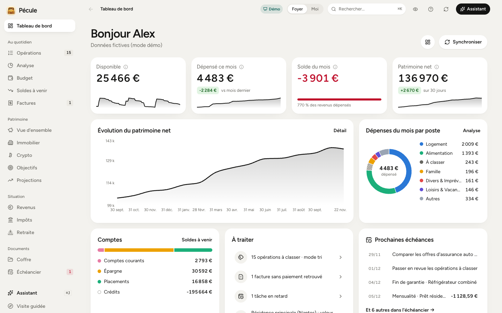
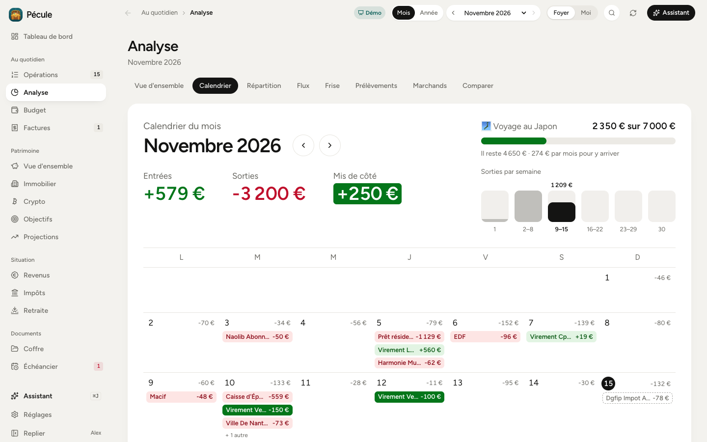
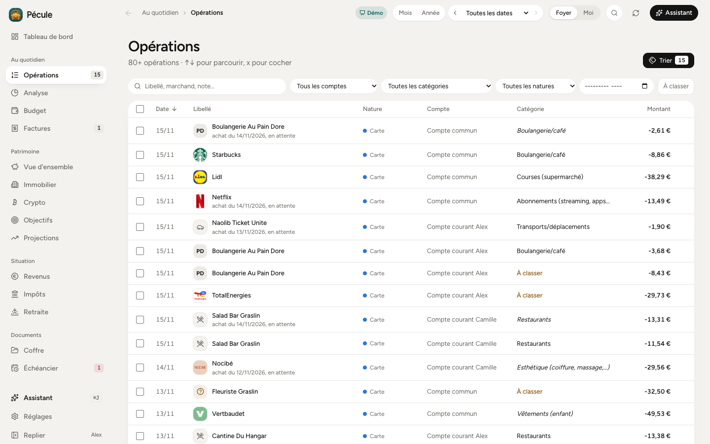
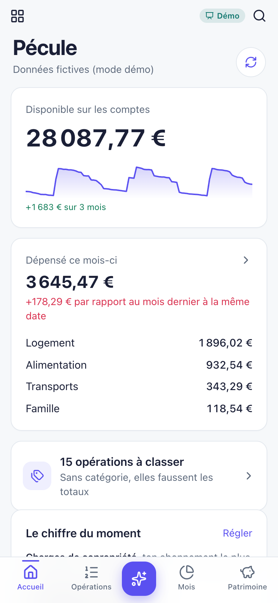
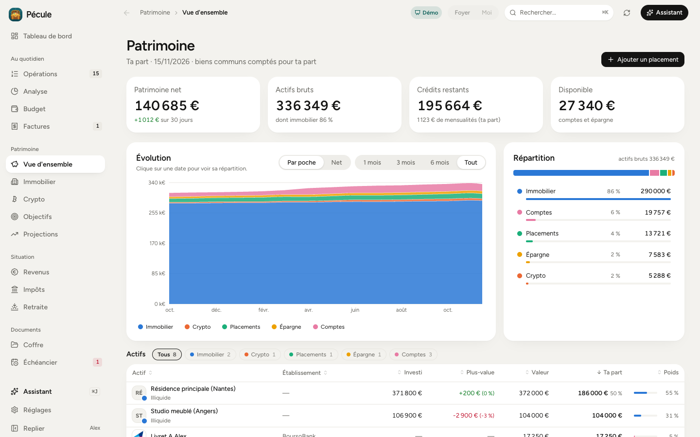

# Pécule

**Le suivi des finances de votre foyer, hébergé chez vous** — comptes, opérations, catégories, patrimoine, factures,
documents, impôts et retraite, sur ordinateur et sur téléphone. Une installation sert un foyer ; vos données restent
sur votre serveur.

[Read in English](README.md)



Pécule est pensé d'abord pour la France et l'euro (banques françaises, avis d'impôt, bulletins de paie, relevés de
carrière), et parle français, anglais, allemand, italien et espagnol. Le code et ses commentaires sont en français.

## Ce qu'il fait

- **Au quotidien** — les opérations de tous vos comptes au même endroit, classées par des règles que vous lui
  apprenez, l'analyse du mois, des enveloppes de budget, les factures reliées aux opérations qui les ont payées.
- **Patrimoine** — épargne, placements, immobilier, crédits et leurs échéanciers, crypto, projections.
- **Situation** — bulletins de paie, impôt sur le revenu et taxe foncière, carrière et estimations de retraite.
- **Coffre** — chaque document gardé, retrouvable, avec ses faits clés et l'échéancier de ce qui arrive.
- **Import massif de documents** — déposez un dossier entier ; Pécule range chaque document, lit ceux qu'il connaît
  (bulletins, avis d'impôt, tableaux d'amortissement, relevés, actes, baux…), vérifie les comptes et propose les
  données. Rien n'est écrit avant votre validation, et tout import s'annule.
- **Assistant** (facultatif) — posez vos questions, à la voix si vous voulez ; il peut agir, avec votre confirmation.
  Il connaît aussi l'appli : il explique comment faire, renvoie au bon écran et change un réglage si vous le demandez.
  Pécule expose aussi un serveur MCP : votre propre assistant IA peut le lire et le tenir à jour.
- **Manuel intégré** — tout ce que sait faire l'appli, par thème, avec une recherche, dans les cinq langues.
- **Un accueil qui guide** — à sa première connexion, chaque membre est accueilli par une courte présentation : le
  foyer à régler, les repères de l'appli, puis sa banque à relier, pas à pas. Une visite guidée fait ensuite le tour
  de l'appli, une bulle après l'autre, et se rejoue depuis le menu.
- **Dans votre devise** — le foyer choisit son pays, sa devise et son fuseau horaire ; un compte tenu dans une autre
  devise est converti au cours de référence de la Banque centrale européenne du jour de chaque opération, et garde ses
  montants d'origine.
- **Pour un foyer** — chaque membre a sa vue ; des comptes communs et des comptes privés ; des clés d'accès à la
  place des mots de passe ; un mode démo avec une famille fictive, pour montrer l'appli sans montrer vos comptes.

| | |
| --- | --- |
|  |  |
|  |  |

## D'où viennent les données

Rien n'est obligatoire : prenez ce qui vous convient.

| Source | Comment |
| --- | --- |
| Votre banque, en lecture seule | [Enable Banking](docs/connecteurs/enable-banking.md) (DSP2, gratuit pour un usage personnel) |
| Fichiers de la banque | exports OFX, QIF ou CSV, réimportables sans doublon |
| À la main | comptes et opérations que vous tenez vous-même |
| Documents | l'import massif, ou un fichier à la fois |

Les fonctions d'IA (lecture des factures et des documents, assistant) passent par **votre** clé de fournisseur —
Claude par l'API d'Anthropic, Microsoft Foundry, ou une passerelle compatible. Sans clé, tout le reste fonctionne.

## Installer

Chaque version est livrée sous trois formats, joints à [sa page](https://github.com/Enki-Engineer/pecule/releases/latest) :

| Format | Pour qui | Ce qu'il faut |
| --- | --- | --- |
| **Docker** — un fichier, `compose.yaml` | Un ordinateur, un serveur, un NAS. Le plus simple : l'appli et sa base ensemble. | Docker avec Compose 2 (essayé de la 2.9 à la 5.5) |
| **Archive prête à l'emploi** — `npm create pecule`, ou `pecule.tar.gz` / `pecule.zip` à la main | Un hébergement Node.js sans Docker. Le serveur est déjà construit. | Node.js 24, MariaDB 10.6+ ou MySQL 8+ |
| **Sources** — `git clone -b stable` | Contribuer, ou un hébergeur qui construit depuis GitHub. | Node.js 24, pnpm, une base |

Avec Docker, trois commandes — rien à cloner, pas de Node, aucun fichier de réglages à écrire :

```sh
curl -fsSLO https://github.com/Enki-Engineer/pecule/releases/latest/download/compose.yaml
docker compose up -d                                 # http://localhost:3000
docker compose exec pecule node scripts/lien.mjs     # le lien à ouvrir pour créer votre foyer
```

Sans Docker — Node.js 24 et une base MariaDB ou MySQL vide —, une commande va chercher l'archive prête à l'emploi de
la dernière version, la contrôle et la déplie dans `./pecule`, puis affiche les trois commandes qui suivent
(réglages, serveur, premier lien) :

```sh
npm create pecule
```

**Ou laissez faire votre assistant IA** — Claude Code, Codex, Gemini CLI, Cursor, Copilot, tout agent capable de
lancer des commandes. Collez-lui ceci :

> Installe Pécule pour moi en suivant les consignes de
> https://raw.githubusercontent.com/Enki-Engineer/pecule/stable/AGENTS.md — lis ce fichier en entier avec curl.
> Je veux l'essayer sur cet ordinateur.

Le [guide d'installation](docs/guide/installation.md) traite du serveur en https, de l'archive, des sauvegardes et
du changement de serveur ; [installer avec une IA](docs/guide/installer-avec-une-ia.md) dit ce que fait l'agent et
ce qui reste à vous (Claude Code : `/plugin install pecule --marketplace Enki-Engineer/pecule` lui donne la
compétence). Pécule prévient son administrateur quand une version est publiée et affiche la commande qui l'installe
([mettre à jour](docs/guide/mise-a-jour.md)). Une fois le serveur en place, ajoutez Pécule à l'écran d'accueil du
téléphone ou au Dock : il se comporte comme une appli.

## Documentation

- [Installation](docs/guide/installation.md) · [Installer avec une IA](docs/guide/installer-avec-une-ia.md) · [Mettre à jour](docs/guide/mise-a-jour.md)
- [Relier ses banques avec Enable Banking](docs/connecteurs/enable-banking.md)
- [Importer ses documents](docs/guide/importer-des-documents.md) · [Où récupérer ses documents](docs/guide/recuperer-ses-documents.md)
- [Architecture](docs/ARCHITECTURE.md) · [Contribuer](CONTRIBUTING.md) · [Sécurité](SECURITY.md)

## Socle technique

Node.js 24, Express 5, React 19, Vite, Tailwind CSS 4, TypeScript, Drizzle ORM, MySQL ou MariaDB. Aucun compte chez
nous, aucune télémétrie, aucun service extérieur obligatoire.

## Licence

[AGPL-3.0-only](LICENSE). Si vous faites tourner un Pécule modifié pour d'autres, vous devez leur en offrir le code.

Pécule est un projet personnel partagé tel quel. Ce n'est ni un conseil financier, ni fiscal, ni juridique.
