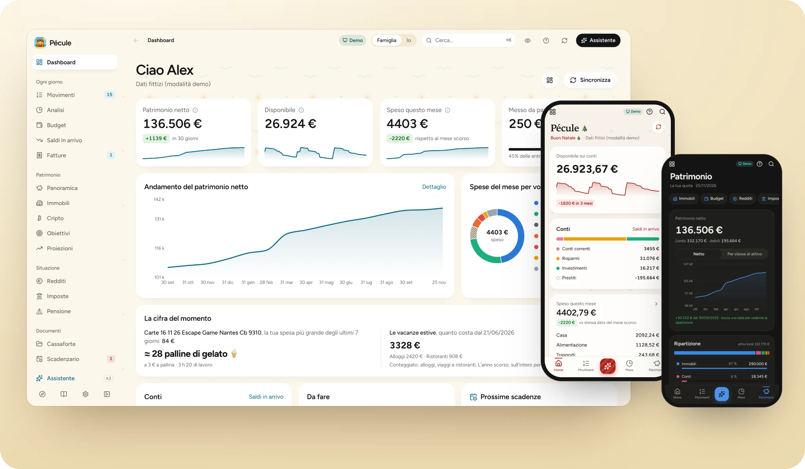
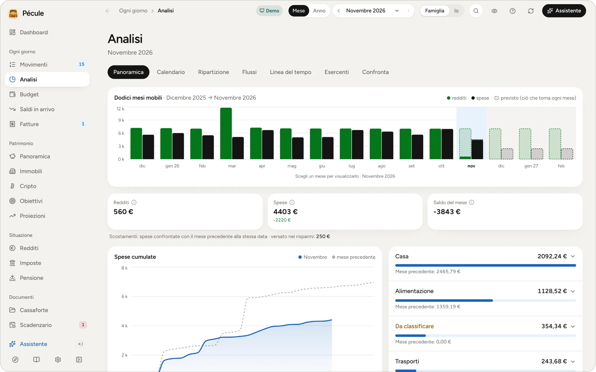
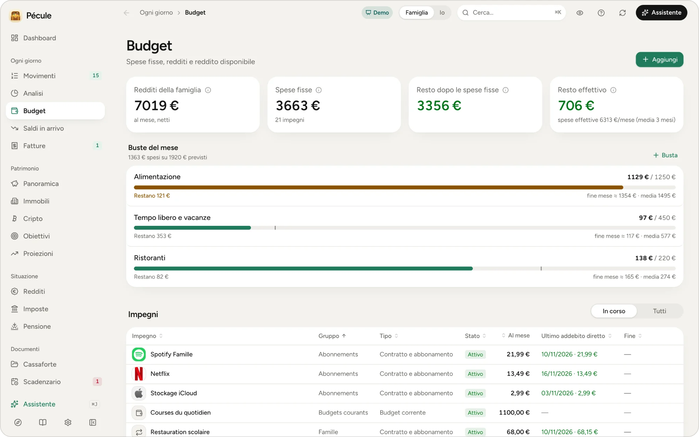
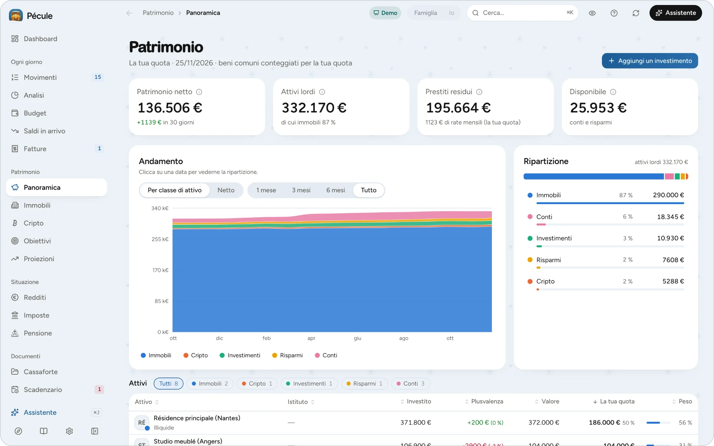
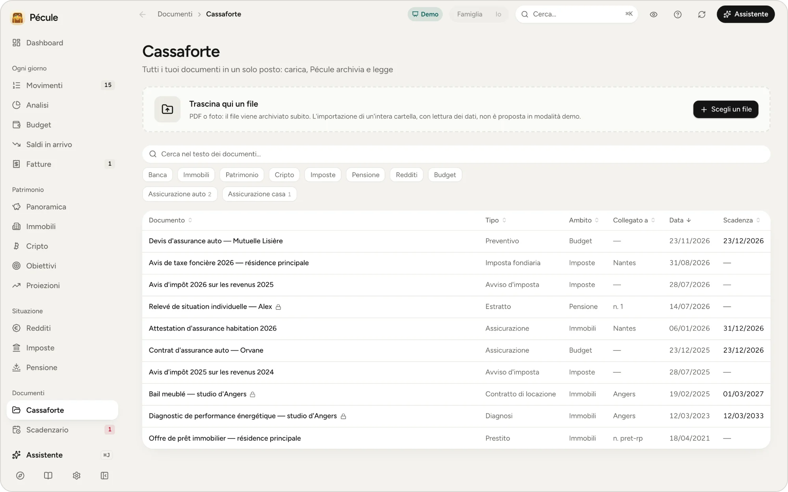
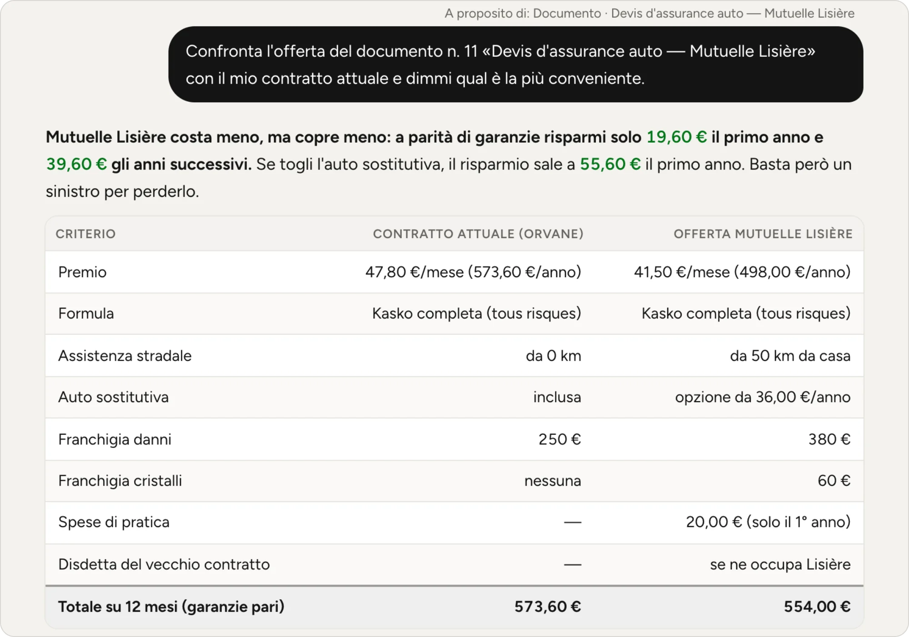
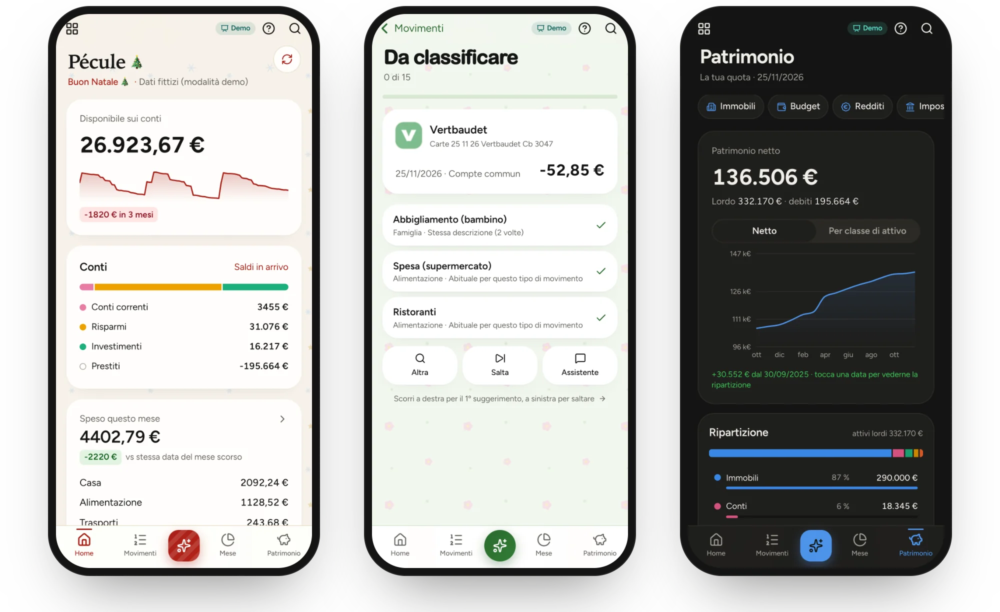
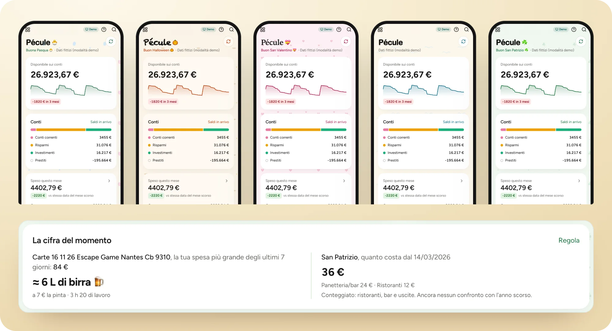

<div align="center">


# Pécule

**Tutte le finanze della tua famiglia. In una cassaforte che ti appartiene.**

Conti, budget, patrimonio, fatture, documenti, imposte e pensione, sul computer e sul telefono.<br>
Ospitato da te, gratuito, libero e open source: i tuoi dati restano sul tuo server.

[](https://github.com/Enki-Engineer/pecule/releases/latest)
[](LICENSE)
[](https://github.com/Enki-Engineer/pecule/actions/workflows/ci.yml)
[](#installare)
[](#cosa-fa)

[Installare](#installare) · [Cosa fa](#cosa-fa) · [Con i tuoi colori](#con-i-tuoi-colori) · [Collega la tua IA](#collega-la-tua-ia) · [I tuoi dati](#i-tuoi-dati-sono-tuoi) · [Documentazione](#documentazione) · [Sostenere](#sostenere-pécule) · [Proponi un'idea](https://github.com/Enki-Engineer/pecule/issues/new?template=idee.md)

[English](README.md) · [Français](README.fr.md) · [Deutsch](README.de.md) · **Italiano** · [Español](README.es.md)

</div>

<picture>
  <source media="(prefers-color-scheme: dark)" srcset="docs/images/it/ouverture-sombre.webp">
  
</picture>

Pécule è pensato anzitutto per la Francia e l'euro (banche francesi, avvisi d'imposta, buste paga, estratti
contributivi) e parla francese, inglese, tedesco, italiano e spagnolo. Un'installazione serve una famiglia. Il codice e
i suoi commenti sono scritti in francese.

## Cosa fa

- **Ogni giorno** — i movimenti di tutti i tuoi conti in un unico posto, classificati con regole che gli insegni,
  l'analisi del mese, le buste di budget, i saldi in arrivo, le fatture collegate ai movimenti che le hanno pagate.
- **Patrimonio** — risparmi, investimenti, immobili, prestiti con i loro piani di ammortamento, cripto, proiezioni.
- **Analisi** — un mese o un anno da sei angolazioni: dodici mesi con la previsione, la ripartizione ad anelli, il
  diagramma dei flussi, il calendario degli addebiti, la linea del tempo dei pagamenti e un periodo a confronto con un
  altro.
- **Busta paga** — le tue buste paga lette mese dopo mese (lordo, netto imponibile, imposta trattenuta, netto pagato,
  premi), per te o per la famiglia.
- **Imposte** — i tuoi avvisi letti anno dopo anno: reddito imponibile, imposta netta, aliquota marginale, aliquota
  media, riduzioni e crediti, imposta fondiaria di ogni immobile; il calendario fiscale nel tuo scadenzario. Chiedi
  all'assistente che cosa cambierebbe una donazione o un versamento su un piano pensionistico, o quali spese possono
  dare diritto a un credito d'imposta.
- **Pensione** — trimestri, carriera e pensione secondo l'età di uscita; le simulazioni ufficiali accanto a una
  carriera completa o a uno stop a 55 anni (FIRE), età per età. *Imposte e pensione leggono oggi documenti francesi;
  altri paesi seguiranno.*
- **Cassaforte** — ogni documento conservato e ritrovabile, con i suoi dati chiave e lo scadenzario di ciò che arriva.
- **Importazione in blocco di documenti** — deposita un'intera cartella; Pécule archivia ogni documento, legge quelli che
  conosce (buste paga, avvisi d'imposta, piani di ammortamento, estratti conto, atti, contratti d'affitto…), verifica i
  conti e propone i dati. Nulla viene scritto prima della tua conferma, e ogni importazione si annulla.
- **Assistente** (facoltativo) — fai le tue domande, anche a voce; può agire, con la tua conferma. Conosce anche
  l'app: spiega come fare, rimanda alla schermata giusta e cambia un'impostazione se glielo chiedi.
- **Manuale integrato** — tutto ciò che l'app sa fare, per tema, con una ricerca, in tutte e cinque le lingue.
- **Un avvio guidato** — al primo accesso ogni membro è accolto da una breve presentazione: la famiglia da impostare, i
  punti di riferimento dell'app, poi la propria banca da collegare, passo dopo passo. Una visita guidata fa poi il giro
  dell'app, una nuvoletta dopo l'altra, e si può ripetere dal menu.
- **Nella tua valuta** — la famiglia sceglie paese, valuta e fuso orario; un conto tenuto in un'altra valuta è convertito
  al tasso di riferimento della Banca centrale europea del giorno di ogni movimento e conserva gli importi originali.
- **Per una famiglia** — ogni membro ha la sua vista; conti comuni e conti privati; passkey al posto delle password;
  una modalità demo con una famiglia fittizia, per mostrare l'app senza mostrare i tuoi conti.

<table>
  <tr>
    <td width="50%"><br><sub><b>Analisi</b> — dodici mesi mobili, il mese in corso, dove vanno i soldi</sub></td>
    <td width="50%"><br><sub><b>Budget</b> — spese fisse, quello che resta davvero, buste, impegni</sub></td>
  </tr>
  <tr>
    <td width="50%"><br><sub><b>Patrimonio</b> — il patrimonio netto nel tempo, per tipo di attivo, prestiti compresi</sub></td>
    <td width="50%"><br><sub><b>Cassaforte</b> — ogni documento, ritrovabile, con le sue scadenze</sub></td>
  </tr>
</table>

### Un preventivo? Confronta

Luce, gas, assicurazione, internet, cellulare, auto, prestito: dai un preventivo all'assistente e lui lo confronta
con il tuo contratto in corso — quello che hai davvero pagato in dodici mesi, garanzia per garanzia — e ti dice se
conviene cambiare, e fino a quando puoi disdire.



### Sul tuo telefono

Aggiungi Pécule alla schermata Home: si comporta come un'app, con una modalità di smistamento per classificare i
movimenti del giorno in pochi gesti.



## Con i tuoi colori

Una dashboard che componi scheda per scheda, sette colori, chiaro o scuro, e temi che seguono l'anno — Natale,
Pasqua, Halloween, l'estate… — ognuno con il suo forziere. All'inizio nessun tema è attivo: li accendi tu.

E poiché il denaro non deve essere sempre una cosa seria, le **equivalenze divertenti** scrivono un importo anche
nell'unità del momento: litri di birra a San Patrizio, palline di gelato d'estate, chili di caramelle a Halloween — e,
tutto l'anno, in ore di lavoro, calcolate dalle tue buste paga.



## Collega la tua IA

Pécule espone un **server MCP**: collega il tuo assistente IA preferito e fai tutto da lì — ritrovare un movimento,
classificare un gruppo, analizzare un mese, confrontare un contratto, aggiornare il tuo patrimonio. Sessantotto
strumenti, in sola lettura o con le azioni: legge e agisce sul tuo Pécule, con i diritti che gli dai.

Pécule riconosce Claude, ChatGPT, Mistral Le Chat e Perplexity, oltre a qualsiasi assistente del tuo computer
(Claude Code, Codex, Cursor, Gemini CLI…). Si collegano con la tua passkey; Impostazioni → Conti e connessioni →
«App collegate» indica l'indirizzo.

## I tuoi dati sono tuoi

Pécule si installa da te: i tuoi conti, i tuoi documenti e il tuo storico restano sul tuo server. Nessun account
da aprire presso il progetto, nessuna telemetria, nessuna pubblicità. Nessuna vendita di dati a terzi, nessun
contatto indesiderato.

- **Gratuito, libero e open source** — licenza AGPL-3.0: il codice è pubblico, puoi leggerlo, modificarlo, ospitarlo.
- **Da te** — un'installazione serve una famiglia; i dati restano nel tuo database.
- **Nessuna vendita, nessuna telefonata commerciale** — nessuno ti chiamerà per venderti un prestito o un'assicurazione.
- **Le tue chiavi, non le nostre** — la tua banca in sola lettura con la tua chiave Enable Banking; l'IA, se la vuoi,
  con la tua chiave.

## Da dove arrivano i dati

Niente è obbligatorio: prendi quello che ti serve.

| Fonte | Come |
| --- | --- |
| La tua banca, in sola lettura | [Enable Banking](docs/connecteurs/enable-banking.md) (PSD2, gratuito per uso personale) |
| File della banca | esportazioni OFX, QIF o CSV, reimportabili senza duplicati |
| A mano | conti e movimenti che tieni tu |
| Documenti | l'importazione in blocco, o un file alla volta |

Le funzioni di IA (lettura di fatture e documenti, assistente) passano dalla **tua** chiave del fornitore — Claude
tramite l'API di Anthropic, Microsoft Foundry o un gateway compatibile. Senza chiave, tutto il resto funziona.

## Installare

Ogni versione esce in tre formati, allegati alla [sua pagina](https://github.com/Enki-Engineer/pecule/releases/latest):

| Formato | Per chi | Cosa serve |
| --- | --- | --- |
| **Docker** — un file, `compose.yaml` | Un computer, un server, un NAS. Il più semplice: l'app e il suo database insieme. | Docker con Compose 2 (provato dalla 2.9 alla 5.5) |
| **Archivio pronto all'uso** — `npm create pecule`, oppure `pecule.tar.gz` / `pecule.zip` a mano | Un hosting Node.js senza Docker. Il server è già compilato. | Node.js 24, MariaDB 10.6+ o MySQL 8+ |
| **Sorgenti** — `git clone -b stable` | Contribuire, o un hosting che compila da GitHub. | Node.js 24, pnpm, un database |

Con Docker, tre comandi — niente da clonare, niente Node, nessun file di impostazioni da scrivere:

```sh
curl -fsSLO https://github.com/Enki-Engineer/pecule/releases/latest/download/compose.yaml
docker compose up -d                                 # http://localhost:3000
docker compose exec pecule node scripts/lien.mjs     # il link da aprire per creare la tua famiglia
```

Senza Docker — Node.js 24 e un database MariaDB o MySQL vuoto — un comando scarica l'archivio pronto all'uso
dell'ultima versione, lo verifica e lo estrae in `./pecule`, poi mostra i tre comandi che seguono (impostazioni,
server, primo link):

```sh
npm create pecule
```

**Oppure lascia fare al tuo assistente IA** — Claude Code, Codex, Gemini CLI, Cursor, Copilot, qualsiasi agente
capace di eseguire comandi. Incollagli questo:

> Installa Pécule per me seguendo le istruzioni di
> https://raw.githubusercontent.com/Enki-Engineer/pecule/stable/AGENTS.md — leggi tutto il file con curl.
> Voglio provarlo su questo computer.

La [guida all'installazione](docs/guide/installation.md) tratta del server in https, dell'archivio, dei backup e
del cambio di server; [installare con un'IA](docs/guide/installer-avec-une-ia.md) dice cosa fa l'agente e cosa resta a
te (Claude Code: `/plugin install pecule --marketplace Enki-Engineer/pecule` gli dà la competenza). Pécule avvisa il
suo amministratore quando esce una versione e mostra il comando che la installa
([aggiornare](docs/guide/mise-a-jour.md)). Con il server in funzione, aggiungi Pécule alla schermata Home del telefono
o al Dock: si comporta come un'app. Le guide sono scritte in francese.

## Documentazione

- [Installazione](docs/guide/installation.md) · [Installare con un'IA](docs/guide/installer-avec-une-ia.md) · [Aggiornare](docs/guide/mise-a-jour.md)
- [Collegare le banche con Enable Banking](docs/connecteurs/enable-banking.md)
- [Importare i documenti](docs/guide/importer-des-documents.md) · [Dove recuperare i documenti](docs/guide/recuperer-ses-documents.md)
- [Architettura](docs/ARCHITECTURE.md) · [Contribuire](CONTRIBUTING.md) · [Sicurezza](SECURITY.md)

## Un progetto giovane, che va veloce

La prima versione pubblica di Pécule è del novembre 2026, e ogni settimana arrivano novità: le
[note di versione](https://github.com/Enki-Engineer/pecule/releases) dicono cosa cambia per una famiglia.

- Un'idea, qualcosa che manca? [Proponila](https://github.com/Enki-Engineer/pecule/issues/new?template=idee.md).
- Qualcosa non funziona? [Segnala un problema](https://github.com/Enki-Engineer/pecule/issues/new?template=probleme.md)
  (non allegare mai dati bancari reali: la modalità demo permette quasi sempre di riprodurlo).
- Vuoi dare una mano sul codice? Vedi [Contribuire](CONTRIBUTING.md).

## Sostenere Pécule

Pécule è gratuito e lo resterà. Per aiutare: una stella su questa pagina (non costa nulla e conta), parlane in giro,
[proponi un'idea](https://github.com/Enki-Engineer/pecule/issues/new?template=idee.md) — oppure offrimi un caffè:

**Bitcoin (BTC)**

```text
bc1q6d23e8fkm7fnz3ulzj97mpdhh7h6kk4lesxhvu
```

**Ethereum (ETH)**

```text
0xDb3f435b19237881Ab00Bfa88FE397516DC36cF7
```

Entrambi gli indirizzi sono dedicati alle donazioni per Pécule.

## Tecnologie

Node.js 24, Express 5, React 19, Vite, Tailwind CSS 4, TypeScript, Drizzle ORM, MySQL o MariaDB. Nessun account
presso di noi, nessuna telemetria, nessun servizio esterno obbligatorio.

## Ringraziamenti

A [Enable Banking](https://enablebanking.com), che offre gratuitamente il suo servizio per uso personale: è grazie a
loro che Pécule legge i tuoi conti in sola lettura, attraverso il canale ufficiale previsto dalla regolamentazione
europea (PSD2). Dai il tuo consenso presso la tua banca, e Pécule non vede mai le tue credenziali.

## Autore

Pécule è creato e mantenuto da **Kevin Ferreira** —
[LinkedIn](https://www.linkedin.com/in/ferreirakevin) · [GitHub](https://github.com/kfr-kevinferreira).

## Licenza

[AGPL-3.0-only](LICENSE). Se fai girare un Pécule modificato per altri, devi offrire loro il codice sorgente.

Pécule è un progetto personale condiviso così com'è. Non è una consulenza finanziaria, fiscale o legale.
