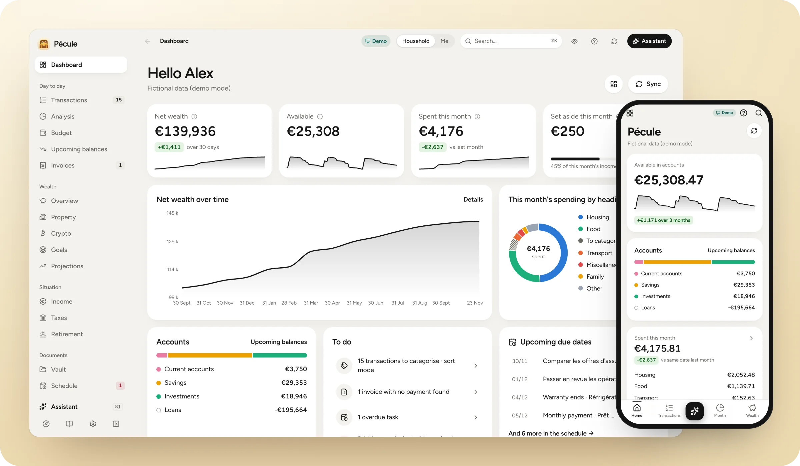
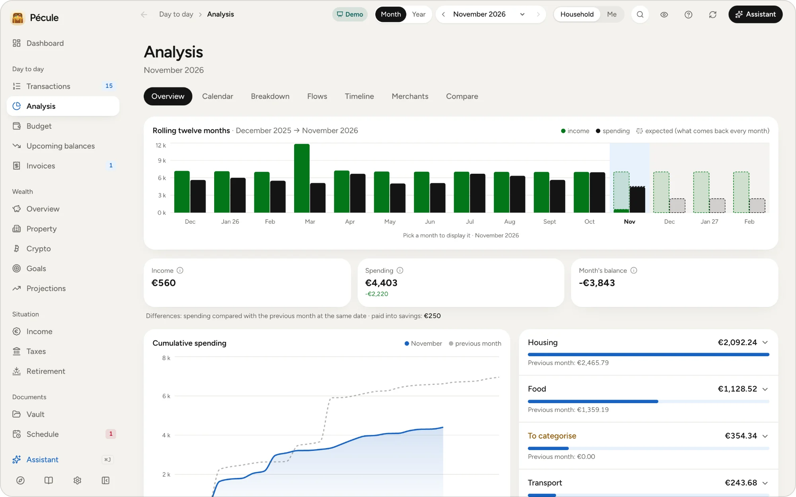
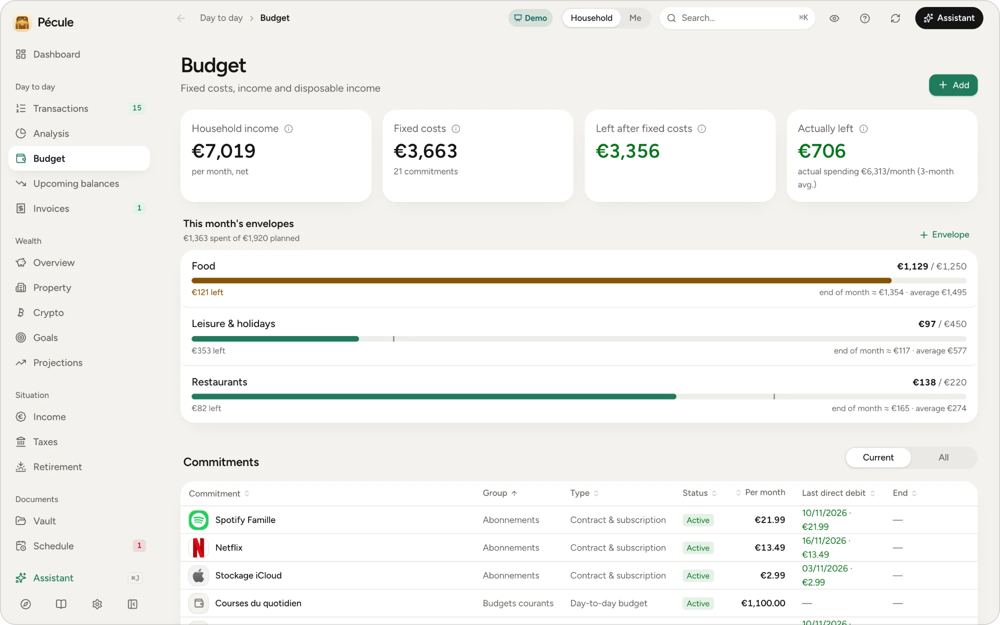
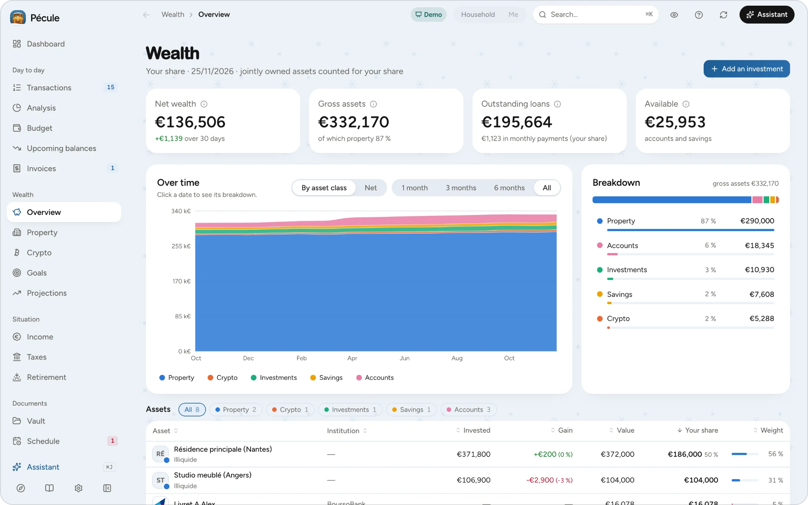
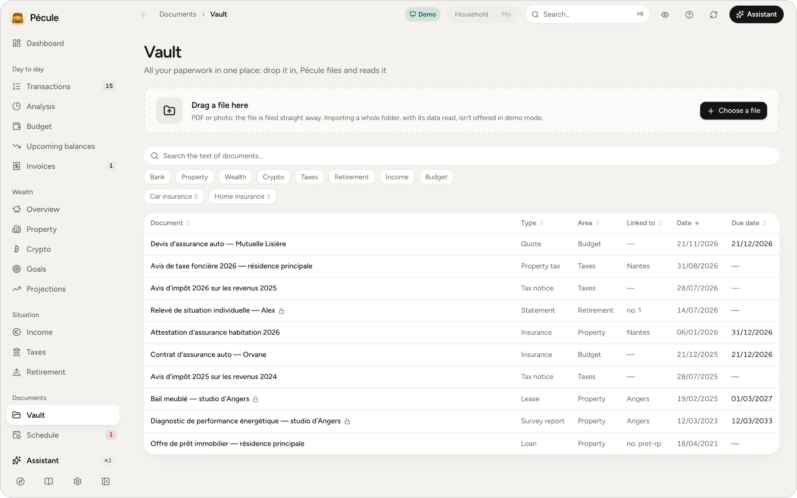
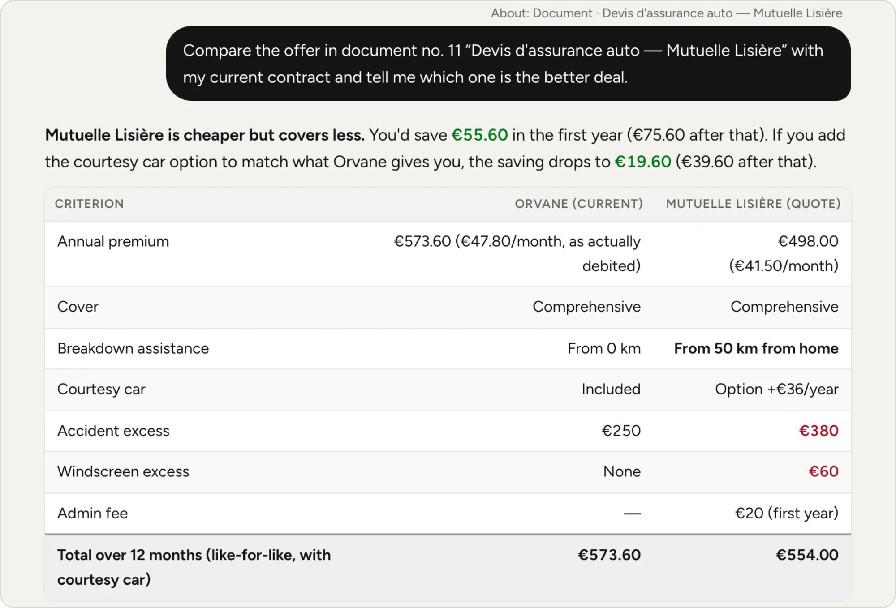
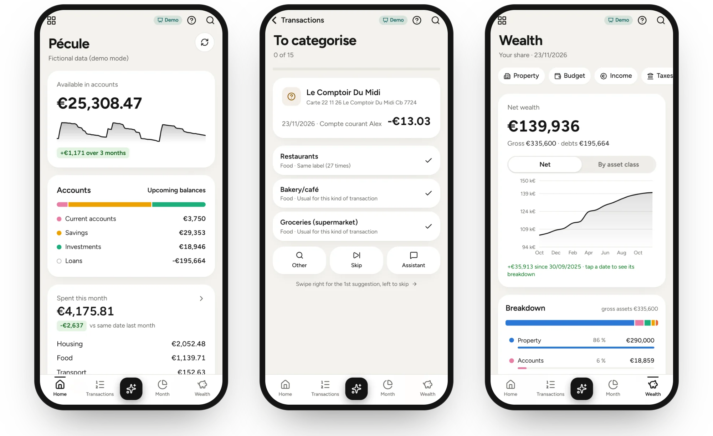
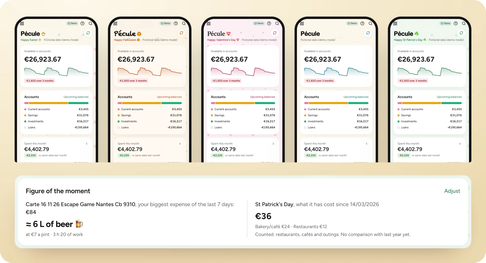

<div align="center">


# Pécule

**All your household's finances. In a vault that belongs to you.**

Accounts, budget, net worth, invoices, documents, taxes and retirement, on desktop and on your phone.<br>
Self-hosted, free and open source: your data stays on your server.

[](https://pecule.org/en/)
[](https://github.com/Enki-Engineer/pecule/releases/latest)
[](LICENSE)
[](https://github.com/Enki-Engineer/pecule/actions/workflows/ci.yml)
[](#install)
[](#what-it-does)

[Website](https://pecule.org/en/) · [Install](#install) · [What it does](#what-it-does) · [Make it yours](#make-it-yours) · [Plug in your AI](#plug-in-your-ai) · [Your data](#your-data-stays-yours) · [Documentation](#documentation) · [Support](#support-the-project) · [Suggest an idea](https://github.com/Enki-Engineer/pecule/issues/new?template=idee.md)

**English** · [Français](README.fr.md) · [Deutsch](README.de.md) · [Italiano](README.it.md) · [Español](README.es.md)

</div>

<picture>
  <source media="(prefers-color-scheme: dark)" srcset="docs/images/en/ouverture-sombre.webp">
  
</picture>

Pécule is built for France and the euro first (French banks, tax notices, payslips, pension statements), and speaks
French, English, German, Italian and Spanish. One installation serves one household. The code and its comments are
written in French.

**Pécule in 70 seconds**

https://github.com/user-attachments/assets/1fe650f7-87a4-414a-a726-2bdbf8f4a193

## What it does

- **Day to day** — transactions from all your accounts in one place, categorised by rules you can teach, monthly
  analysis, budget envelopes, upcoming balances, invoices matched to the transactions that paid them.
- **Wealth** — savings, investments, property, loans with their amortisation schedules, crypto, projections.
- **Analysis** — a month or a year from six angles: twelve months with a forecast, breakdown rings, a flow diagram, a
  calendar of debits, a payment timeline, and one period against another.
- **Pay** — payslips read month by month (gross, taxable net, tax withheld, net pay, bonuses), for you or for the
  household.
- **Taxes** — your notices read year after year: taxable income, net tax, marginal band, average rate, reductions and
  credits, property tax on each property; the tax calendar in your schedule. Ask the assistant what a donation or a
  pension-plan contribution would change, or which expenses may qualify for a tax credit.
- **Retirement** — quarters, career and pension by retirement age; the official simulations next to a full career or
  stopping work at 55 (FIRE), age by age. *Taxes and retirement currently read French documents; other countries will
  follow.*
- **Vault** — every document kept, searchable, with its key facts and a schedule of what is due.
- **Bulk document import** — drop a whole folder; Pécule files each document, reads the ones it knows (payslips, tax
  notices, loan schedules, bank statements, deeds, leases…), checks the arithmetic, and proposes the data. Nothing is
  written before you validate it, and every import can be undone.
- **Assistant** (optional) — ask questions about your finances, hands-free if you like; it can act, with your
  confirmation. It knows the app too: it explains how to do things, links to the right screen and changes a setting
  when you ask.
- **Built-in manual** — everything the app does, by topic, searchable, in all five languages.
- **A guided start** — on their first sign-in, each member is welcomed by a short introduction: the household to set
  up, the app's landmarks, then their bank to link, step by step. A guided tour then walks through the app itself, one
  bubble at a time, and can be replayed from the menu.
- **Any currency** — the household picks its country, currency and time zone; an account held in another currency is
  converted at the European Central Bank reference rate of each transaction's day and keeps its original amounts.
- **For a household** — each member has their own view; shared accounts and private ones; passkeys instead of
  passwords; a demo mode with a fictional family to show the app without showing your accounts.

<table>
  <tr>
    <td width="50%"><br><sub><b>Analysis</b> — twelve rolling months, the month so far, where the money goes</sub></td>
    <td width="50%"><br><sub><b>Budget</b> — fixed costs, what is really left, envelopes, commitments</sub></td>
  </tr>
  <tr>
    <td width="50%"><br><sub><b>Wealth</b> — net wealth over time, by asset class, with loans</sub></td>
    <td width="50%"><br><sub><b>Vault</b> — every document, searchable, with its due dates</sub></td>
  </tr>
</table>

### Got a quote? Compare it

Electricity, gas, insurance, broadband, mobile, car, loan: hand the assistant a quote and it compares it with the
contract you have — what you really paid over twelve months, cover by cover — and tells you whether it is worth
switching, and until when you can cancel.



### On your phone

Add Pécule to your home screen: it behaves like an app, with a sort mode to categorise the day's transactions in a
few swipes.



## Make it yours

A dashboard you arrange card by card, seven colours, light or dark, and themes that follow the year — Christmas,
Easter, Halloween, summer… — each with its own treasure chest. No theme is on at first: you switch them on.

And because money does not always have to be serious, **fun equivalents** also write an amount in the unit of
the moment: litres of beer on St Patrick's Day, scoops of ice cream in summer, kilos of sweets at Halloween — and, all
year round, in hours of work, worked out from your payslips.



## Plug in your AI

Pécule exposes an **MCP server**: connect your favourite AI assistant and do everything from there — find a
transaction, categorise a batch, analyse a month, compare a contract, update your wealth. Sixty-eight tools, read-only
or with actions: it reads and acts on your Pécule, with the rights you grant.

Pécule recognises Claude, ChatGPT, Mistral Le Chat and Perplexity, as well as any assistant on your computer
(Claude Code, Codex, Cursor, Gemini CLI…). They sign in with your passkey; Settings → Accounts and connections →
"Connected apps" gives the address.

## Your data stays yours

Pécule runs on your own server: your accounts, documents and history stay there. No account to open with the
project, no telemetry, no ads. No data sold to third parties, no unsolicited contact.

- **Free and open source** — AGPL-3.0: the code is public; read it, change it, host it.
- **On your server** — one installation serves one household; the data stays in your database.
- **Never sold, never solicited** — nobody will call you to sell a loan or an insurance policy.
- **Your keys, not ours** — your bank read-only with your own Enable Banking key; AI, if you want it, with your own
  key.

## Where the data comes from

Nothing is mandatory; pick what suits you.

| Source | How |
| --- | --- |
| Your bank, read-only | [Enable Banking](docs/connecteurs/enable-banking.md) (PSD2, free for personal use) |
| Bank files | OFX, QIF or CSV exports, re-importable without duplicates |
| By hand | accounts and transactions you keep yourself |
| Documents | the bulk import, or one file at a time |

The AI features (reading invoices and documents, the assistant) use **your own** provider key — Claude through the
Anthropic API, Microsoft Foundry, or a compatible gateway. Without a key, everything else works.

## Install

Every release ships in three formats, attached to [its page](https://github.com/Enki-Engineer/pecule/releases/latest):

| Format | For | You need |
| --- | --- | --- |
| **Docker** — one file, `compose.yaml` | A computer, a server, a NAS. The simplest: the app and its database together. | Docker with Compose 2 (tested from 2.9 to 5.5) |
| **Ready-to-run archive** — `npm create pecule`, or `pecule.tar.gz` / `pecule.zip` by hand | Node.js hosting without Docker. The server is already built. | Node.js 24, MariaDB 10.6+ or MySQL 8+ |
| **Source** — `git clone -b stable` | Contributing, or a host that builds from GitHub. | Node.js 24, pnpm, a database |

With Docker, three commands — nothing to clone, no Node, no settings file to write:

```sh
curl -fsSLO https://github.com/Enki-Engineer/pecule/releases/latest/download/compose.yaml
docker compose up -d                                 # http://localhost:3000
docker compose exec pecule node scripts/lien.mjs     # the link to open to create your household
```

Without Docker — Node.js 24 and an empty MariaDB or MySQL database — one command fetches the ready-to-run archive of
the latest release, checks it and unpacks it into `./pecule`, then prints the three commands that follow (settings,
server, first link):

```sh
npm create pecule
```

**Or let your AI assistant do it** — Claude Code, Codex, Gemini CLI, Cursor, Copilot, any agent that can run
commands. Paste this, in your own language:

> Install Pécule for me by following the instructions at
> https://raw.githubusercontent.com/Enki-Engineer/pecule/stable/AGENTS.md — read the whole file with curl.
> I want to try it on this computer.

The [installation guide](docs/guide/installation.md) covers a server with https, the archive, backups and moving to
another server; [installing with an AI agent](docs/guide/installer-avec-une-ia.md) says what the agent does and what
stays yours (Claude Code: `/plugin install pecule --marketplace Enki-Engineer/pecule` adds the skill). Pécule tells
its administrator when a new version is released and shows the command that installs it
([updating](docs/guide/mise-a-jour.md)). Once the server runs, add Pécule to your phone's home screen or your Dock:
it behaves like an app. The guides are written in French.

## Documentation

- [Installation](docs/guide/installation.md) · [Installing with an AI agent](docs/guide/installer-avec-une-ia.md) · [Updating](docs/guide/mise-a-jour.md)
- [Connecting your banks with Enable Banking](docs/connecteurs/enable-banking.md)
- [Importing your documents](docs/guide/importer-des-documents.md) · [Where to get your documents](docs/guide/recuperer-ses-documents.md)
- [Architecture](docs/ARCHITECTURE.md) · [Contributing](CONTRIBUTING.md) · [Security](SECURITY.md)

## A young project that moves fast

Pécule's first public release dates from November 2026, and new features arrive every week: the
[release notes](https://github.com/Enki-Engineer/pecule/releases) tell what changes for a household.

- An idea, something missing? [Suggest it](https://github.com/Enki-Engineer/pecule/issues/new?template=idee.md).
- Something does not work? [Report a problem](https://github.com/Enki-Engineer/pecule/issues/new?template=probleme.md)
  (never attach real bank data: the demo mode almost always reproduces it).
- Want to help with the code? See [Contributing](CONTRIBUTING.md).

## Support the project

Pécule is free and will stay free. To help: a star on this page (it costs nothing and it counts), spread the word,
[suggest an idea](https://github.com/Enki-Engineer/pecule/issues/new?template=idee.md) — or buy me a coffee:

**GitHub Sponsors** — [github.com/sponsors/kfr-kevinferreira](https://github.com/sponsors/kfr-kevinferreira): monthly or one-time, the amount you choose.

**Liberapay** — [liberapay.com/pecule](https://liberapay.com/pecule): a recurring donation, by card or direct debit.

**Bitcoin (BTC)**

```text
bc1q6d23e8fkm7fnz3ulzj97mpdhh7h6kk4lesxhvu
```

**Ethereum (ETH)**

```text
0xDb3f435b19237881Ab00Bfa88FE397516DC36cF7
```

Both addresses are dedicated to Pécule donations.

## Stack

Node.js 24, Express 5, React 19, Vite, Tailwind CSS 4, TypeScript, Drizzle ORM, MySQL or MariaDB. No account with us,
no telemetry, no external service required.

## Thanks

To [Enable Banking](https://enablebanking.com), who make their service free for personal use: that is how Pécule
reads your accounts, read-only, through the official channel set by European regulation (PSD2). You give your consent
at your bank, and Pécule never sees your credentials.

## Author

Pécule is created and maintained by **Kevin Ferreira** —
[LinkedIn](https://www.linkedin.com/in/ferreirakevin) · [GitHub](https://github.com/kfr-kevinferreira).

## Licence

[AGPL-3.0-only](LICENSE). If you run a modified Pécule for other people, you must offer them its source.

Pécule is a personal project shared as is. It is not financial, tax or legal advice.
