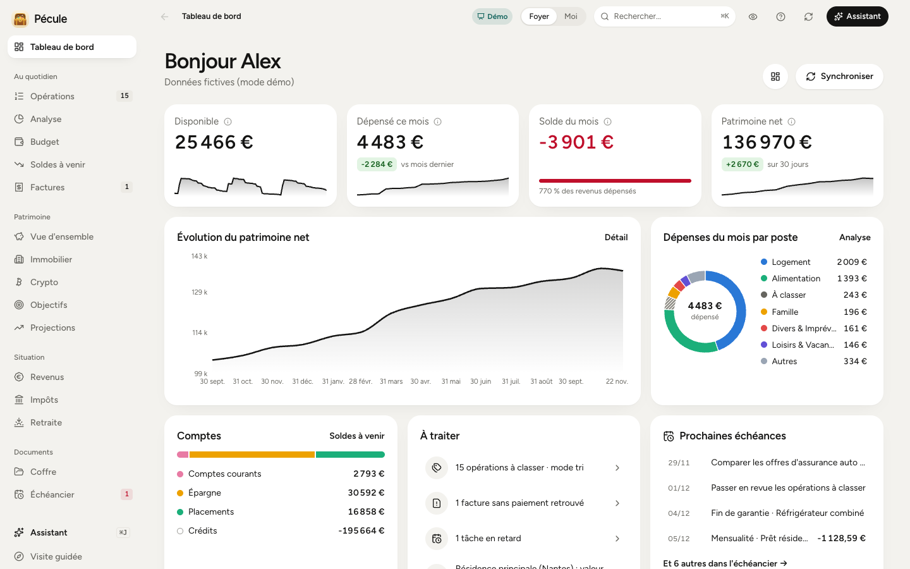
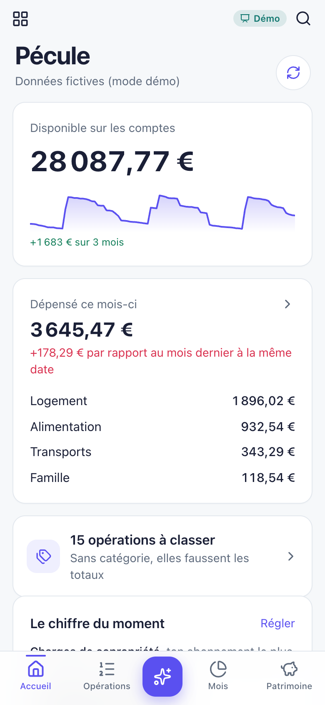
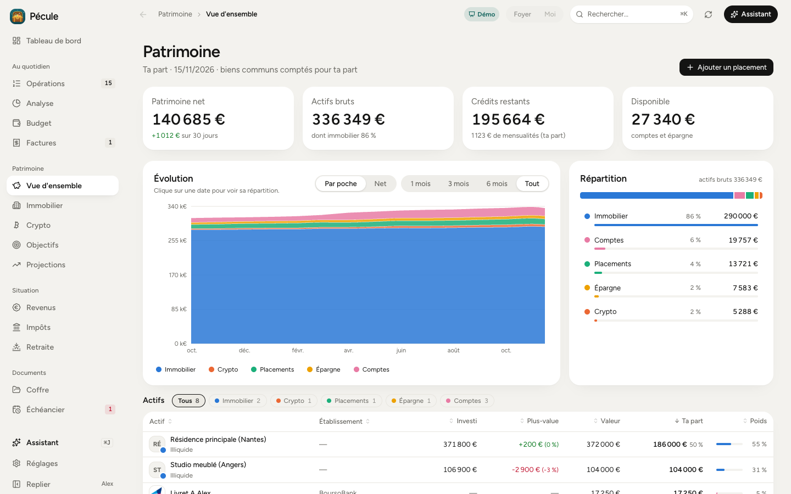

# Pécule

**Self-hosted household finance tracker** — accounts, transactions, categories, wealth, invoices, documents, taxes
and retirement, on desktop and on your phone. One installation serves one household; your data stays on your server.

[Lire en français](README.fr.md)



Pécule is built for France and the euro first (French banks, tax notices, payslips, pension statements), and speaks
French, English, German, Italian and Spanish. The code and its comments are written in French.

## What it does

- **Day to day** — transactions from all your accounts in one place, categorised by rules you can teach, monthly
  analysis, budget envelopes, invoices matched to the transactions that paid them.
- **Wealth** — savings, investments, property, loans with their amortisation schedules, crypto, projections.
- **Situation** — payslips, income tax and property tax, career and pension estimates.
- **Vault** — every document kept, searchable, with its key facts and a schedule of what is due.
- **Bulk document import** — drop a whole folder; Pécule files each document, reads the ones it knows (payslips, tax
  notices, loan schedules, bank statements, deeds, leases…), checks the arithmetic, and proposes the data. Nothing is
  written before you validate it, and every import can be undone.
- **Assistant** (optional) — ask questions about your finances, hands-free if you like; it can act, with your
  confirmation. Hand it a quote (energy, insurance, telecoms, car) and it tells you whether it beats the contract you
  have, with a side-by-side table. It knows the app too: it explains how to do things, links to the right screen and
  changes a setting when you ask. Pécule also exposes an MCP server so your own AI assistant can read and update it.
- **Built-in manual** — everything the app does, by topic, searchable, in all five languages.
- **Any currency** — the household picks its country, currency and time zone; an account held in another currency is
  converted at the European Central Bank reference rate of each transaction's day and keeps its original amounts.
- **For a household** — each member has their own view; shared accounts and private ones; passkeys instead of
  passwords; a demo mode with a fictional family to show the app without showing your accounts.

| | |
| --- | --- |
|  |  |
|  |  |

## Where the data comes from

Nothing is mandatory; pick what suits you.

| Source | How |
| --- | --- |
| Your bank, read-only | [Enable Banking](docs/connecteurs/enable-banking.md) (PSD2, free for personal use) |
| Bank files | OFX, QIF or CSV exports, re-importable without duplicates |
| By hand | accounts and transactions you keep yourself |
| Documents | the bulk import, or one file at a time |

The AI features (reading invoices and documents, the assistant) use **your own** provider key — Claude through the
Anthropic API, Microsoft Foundry, or a compatible gateway. Without a key, everything else works.

## Install

Every release ships in three formats, attached to [its page](https://github.com/Enki-Engineer/pecule/releases/latest):

| Format | For | You need |
| --- | --- | --- |
| **Docker** — one file, `compose.yaml` | A computer, a server, a NAS. The simplest: the app and its database together. | Docker with Compose 2 (tested from 2.9 to 5.5) |
| **Ready-to-run archive** — `pecule.tar.gz` or `pecule.zip` | Node.js hosting without Docker. The server is already built. | Node.js 24, MariaDB 10.6+ or MySQL 8+ |
| **Source** — `git clone -b stable` | Contributing, or a host that builds from GitHub. | Node.js 24, pnpm, a database |

With Docker, three commands — nothing to clone, no Node, no settings file to write:

```sh
curl -fsSLO https://github.com/Enki-Engineer/pecule/releases/latest/download/compose.yaml
docker compose up -d                                 # http://localhost:3000
docker compose exec pecule node scripts/lien.mjs     # the link to open to create your household
```

**Or let your AI assistant do it** — Claude Code, Codex, Gemini CLI, Cursor, Copilot, any agent that can run
commands. Paste this, in your own language:

> Install Pécule for me by following the instructions at
> https://raw.githubusercontent.com/Enki-Engineer/pecule/stable/AGENTS.md — read the whole file with curl.
> I want to try it on this computer.

The [installation guide](docs/guide/installation.md) covers a server with https, the archive, backups and moving to
another server; [installing with an AI agent](docs/guide/installer-avec-une-ia.md) says what the agent does and what
stays yours (Claude Code: `/plugin install pecule --marketplace Enki-Engineer/pecule` adds the skill). Pécule tells
its administrator when a new version is released and shows the command that installs it
([updating](docs/guide/mise-a-jour.md)). Once the server runs, add Pécule to your phone's home screen or your Dock:
it behaves like an app.

## Documentation

- [Installation](docs/guide/installation.md) · [Installing with an AI agent](docs/guide/installer-avec-une-ia.md) · [Updating](docs/guide/mise-a-jour.md)
- [Connecting your banks with Enable Banking](docs/connecteurs/enable-banking.md)
- [Importing your documents](docs/guide/importer-des-documents.md) · [Where to get your documents](docs/guide/recuperer-ses-documents.md)
- [Architecture](docs/ARCHITECTURE.md) · [Contributing](CONTRIBUTING.md) · [Security](SECURITY.md)

## Stack

Node.js 24, Express 5, React 19, Vite, Tailwind CSS 4, TypeScript, Drizzle ORM, MySQL or MariaDB. No account with us,
no telemetry, no external service required.

## Licence

[AGPL-3.0-only](LICENSE). If you run a modified Pécule for other people, you must offer them its source.

Pécule is a personal project shared as is. It is not financial, tax or legal advice.
